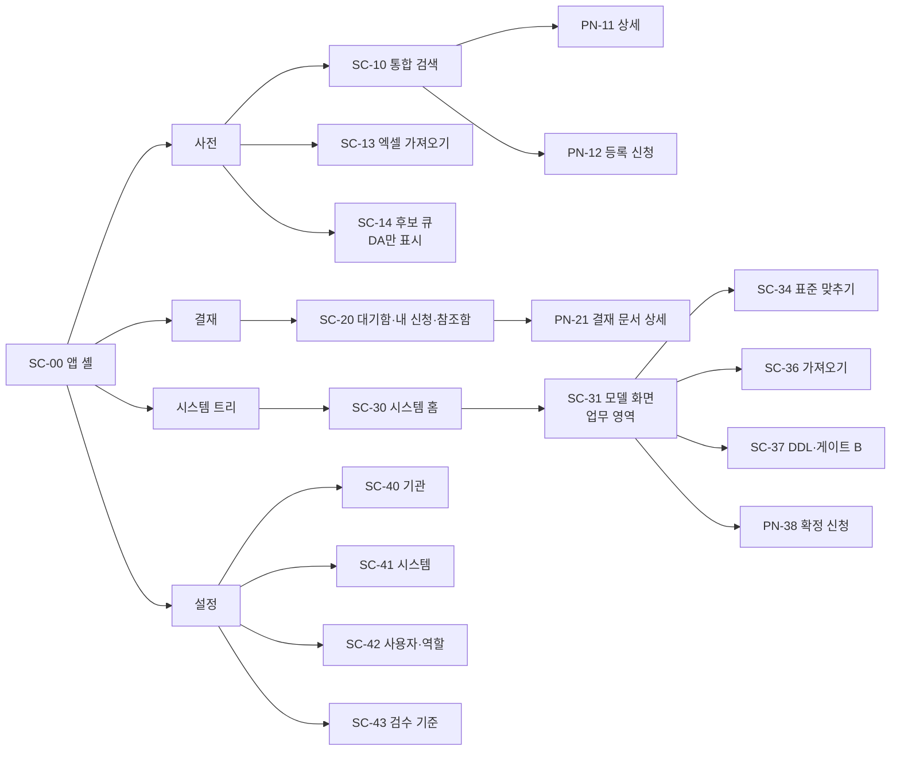
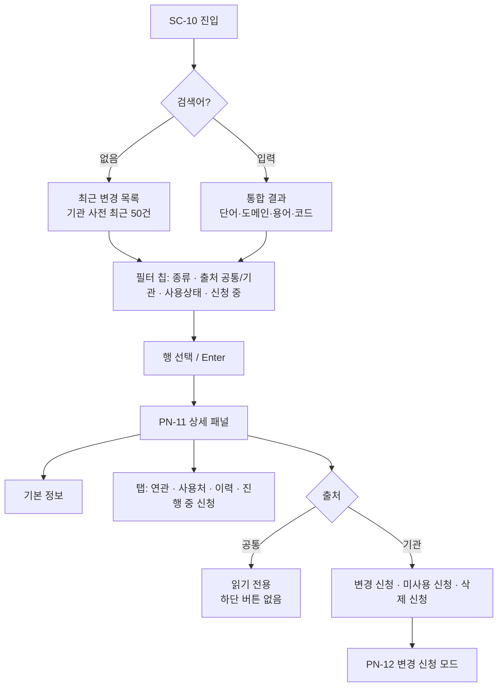
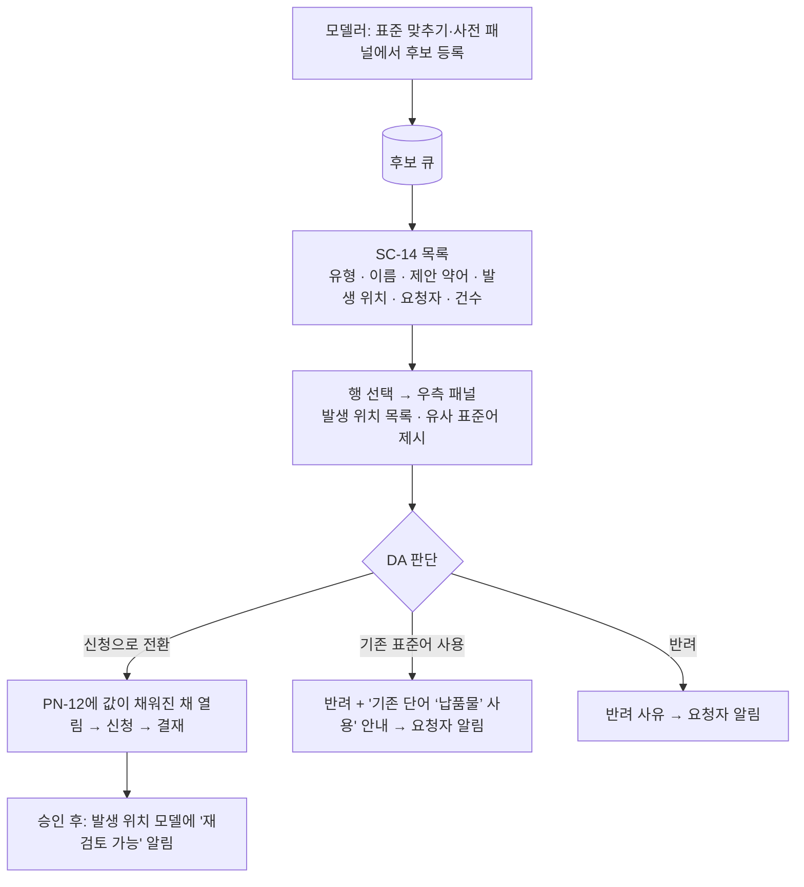
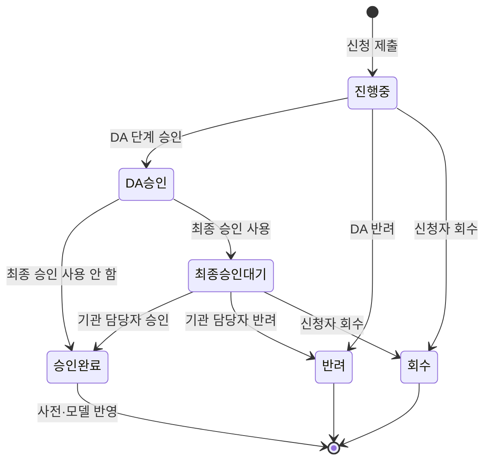
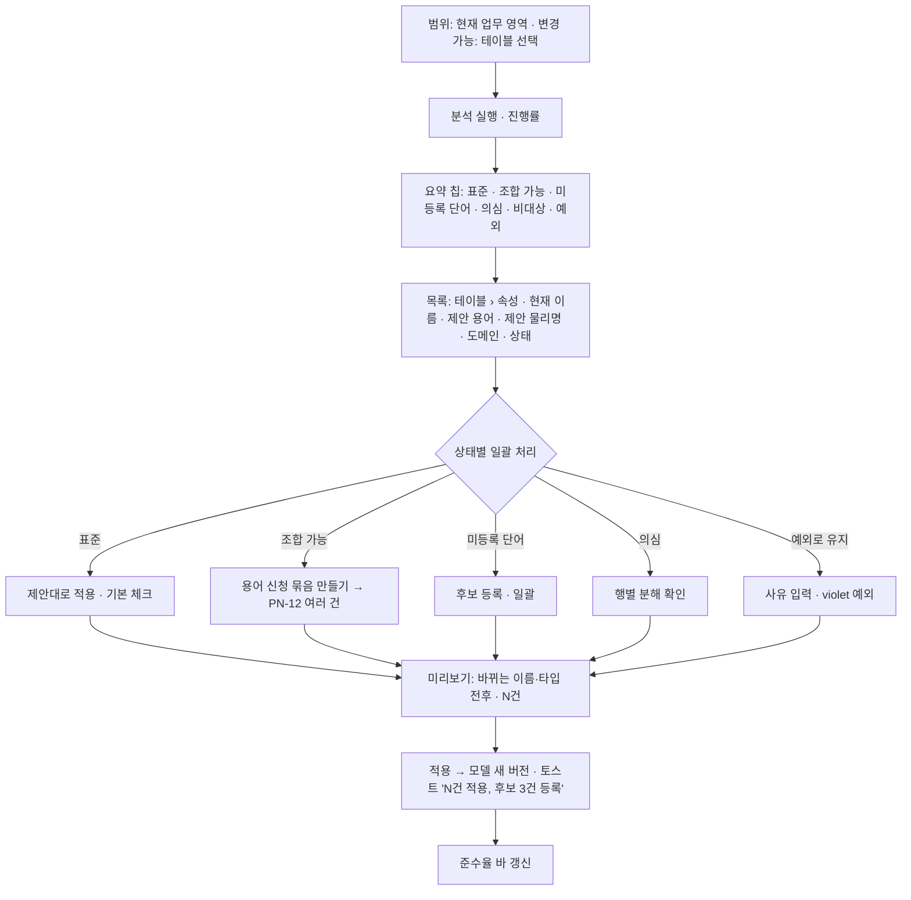
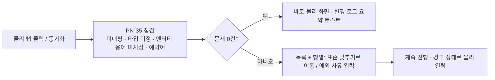
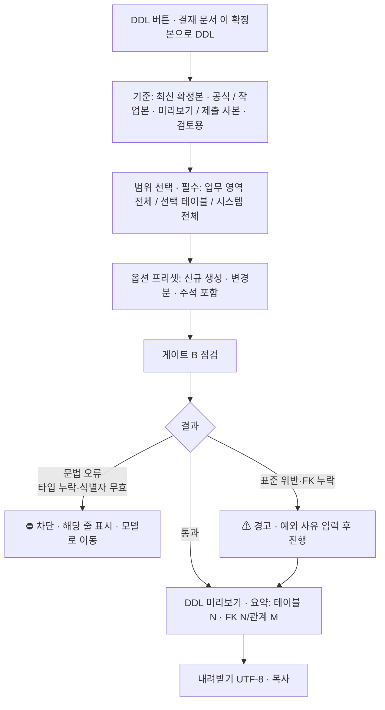
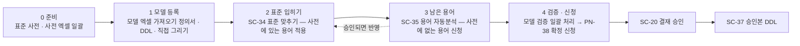

# DBModeler 화면 흐름 설계 v1

> 상태: **v1 초안** (2026-11-17). 다음 단계인 클릭 목업(`docs/ux/mockups/`)의 기준.
> 입력: [00-inputs.md](00-inputs.md)(제품 결정) · [01-design-guide.md](01-design-guide.md)(레이아웃·컴포넌트) · [30-metadata-design.md](../spec/da-feature-spec/30-metadata-design.md)(MD 시나리오) · [20-priority.md](../spec/da-feature-spec/20-priority.md)(요구사항·웨이브).
> 범위: 사전 관리 + 엑셀 가져오기 · 결재 · 표준 맞추기·게이트·준수율 · 기관·시스템 설정. ERD 캔버스는 **자리만** 잡는다(6-2).
> 표기: 화면 ID `SC-xx`, 패널 `PN-xx`, 모달 `MO-xx`. 괄호 안은 근거(입력 항목 번호·MD·요구사항).

## 1. 화면 목록

| ID | 화면 | 형태 | 주 사용자 | 근거 |
|---|---|---|---|---|
| **SC-00** | 앱 셸 (상단 바·좌측 내비·알림·명령 팔레트) | 공통 | 전체 | 1-5, 4-8 |
| **SC-10** | 사전 — 통합 검색 목록 | 목록 + 우측 패널 | 전체 | 3-5~3-7 |
| PN-11 | 사전 항목 상세 (연관·사용처·이력·진행 중 신청) | 우측 패널 | 전체 | 3-7 |
| PN-12 | 사전 등록 신청 (단어·도메인·용어·엔터티 용어·코드) | 우측 패널(넓게 560px) | 모델러·DA | MD-01~07, MD-30 |
| **SC-13** | 엑셀 가져오기 (업로드 → 검증·비교 → 결과 검토·보정 → 신청) — 왕복 편집은 [07](07-dict-excel-roundtrip.md) | 전체 화면 단계형 | 모델러·DA | 3-4, MD-08·09·10 |
| **SC-15** | 업로드 이력 (이어서 작업·보정본·반영본·보류 행·원본) | 목록 + 우측 패널 | 모델러·DA | 07 E4 |
| **SC-16** | 사전 변경 내역 (기간·종류·변경 구분 검색, 필드 비교, 엑셀 보고서 · 시점 비교는 W2) | 목록 + 우측 패널 | 전체 | 07 E5, MD-23 |
| **SC-14** | 후보 큐 | 목록 + 우측 패널 | DA | 5-4, MD-42·43 |
| **SC-20** | 결재 — 대기함 / 내 신청 / 참조함 | 목록 + 우측 패널 | 전체 | 4-1~4-8, MD-20~27 |
| PN-21 | 결재 문서 상세 (전후 값·검사 결과·결재선·예외 목록) | 우측 패널 | 전체 | MD-22 |
| MO-22 | 자기 승인 사유 입력 | 모달 | DA·기관 담당자 | 4-7, MD-25 |
| MO-23 | 반려 의견 입력 | 모달 | DA·기관 담당자 | MD-20 |
| **SC-30** | 시스템 홈 (시스템 개요·업무 영역 목록) | 페이지 | 전체 | 1-5 |
| **SC-31** | 모델 화면 = ERD 캔버스 + 준수율 바 + 패널 (v2 통합, 03-erd-editor) | 작업 화면 | 모델러 | 3-2, 5-1, 5-7 |
| PN-32 | 사전 사이드 패널 (검색·끌어 놓기·후보 등록) | 좌측 보조 패널 | 모델러 | 3-2 |
| PN-33 | 엔터티 패널 (속성·제약·인덱스·보안·관계 탭, 자동완성, 상태 배지) | 우측 패널 | 모델러 | 5-1, LG-R01~03, PH-R |
| PN-31G | 표 보기 (속성 그리드 · 일괄편집 · 찾기/바꾸기 · 비대상 지정) | 캔버스 위 오버레이 | 모델러 | M-H11·H12 (05 §8) |
| PN-39 | 모델 검토 (명칭 중복·미입력·관계·물리 정보) | 우측 패널 | 모델러 | M-D15 (05 §8) |
| **SC-34** | 표준 맞추기 (업무 영역 범위, 4상태, 일괄 처리) | 전체 화면 | 모델러 | 5-1, 5-2, ST-R07 |
| PN-35 | 게이트 A 점검 (물리 열기·동기화 시) | 우측 패널 | 모델러 | 5-6 |
| **SC-36** | 가져오기 (엑셀·DDL → 모델) | 전체 화면 단계형 | 모델러 | 1-8, RV-R01·R02 |
| **SC-37** | DDL 출력 + 게이트 B | 전체 화면 | 모델러 | OUT-R01·R02 |
| PN-37 | DBMS 비교 (모델 ↔ 운영 DB, 후속 차수) | 우측 패널 | 모델러·DA | M-P09 |
| **SC-38** | 산출물 (테이블 정의서·준수검사·용어 사용·개인정보·ERD·검토·변경 이력) | 목록 + 우측 패널 | 모델러·DA | OUT-R, M-D13·D14 |
| PN-38 | 모델 확정 신청 (결재선·참조자·예외 목록 확인) | 우측 패널 | 모델러 | 4-1, 5-5 |
| **SC-55** | 홈 (내 차례 결재·내 신청·최근 업무 영역·새 기능) | 페이지 | 전체 | 06 §3 |
| PN-50 · **SC-51** | 사용자 메뉴 · 마이페이지 (프로필·내 역할·내 신청·알림 설정·보안·환경) | 드롭다운 · 페이지 | 전체 | 06 §3 |
| PN-52 · MO-53 · PN-54 | 알림 센터 · 제품 정보(버전·빌드·릴리스 노트·라이선스) · 단축키 | 드롭다운 · 모달 | 전체 | 06 §3.1 |
| SC-57 | 오류·안내 (403·404·500·점검·로그아웃·세션 만료) | 페이지 | 전체 | 06 §3 |
| SC-58 | 감사 로그 | 목록 | DA·Admin | 06 §3, 06 §5 |
| **SC-40** | 설정 — 기관 (사전·결재선 템플릿·도메인그룹·메일) | 설정 페이지 | Admin | 4-2, 4-5, 4-8 |
| SC-41 | 설정 — 시스템 (DBMS·스키마·명명 템플릿·데이터타입 매핑·시스템 컬럼·최종 승인) | 설정 페이지 | Admin·DA | 1-7, 4-3, MD-40 |
| SC-42 | 설정 — 사용자·역할 | 목록 + 우측 패널 | Admin | 1-3, 4-4 |
| SC-43 | 설정 — 검수 기준 (사전 입력 형식 · 표준 제외 규칙) | 설정 페이지 | DA·Admin | 30 §4, M-O06 |

**1차 목업에서 뺀 화면 (W2)**: 삭제 보관·영구 삭제, 코드값 관리 전용 화면, 기관 대시보드. ~~버전별 이력 전체 화면~~ → **SC-16 사전 변경 내역으로 W1에 올림**(2026-11-18, 엑셀 왕복 편집 업무 반영 · 07 §7).

## 2. 내비게이션 구조



**좌측 내비 구성** (위에서 아래, 역할별 노출):

```
사전                       ← 전체
  통합 검색
  엑셀 가져오기
  후보 큐  (3)             ← DA 역할만
결재  (5)                  ← 대기 건수 배지
시스템
  ▸ 인사시스템  Oracle
      급여 · 인사기본 · 교육
  ▸ 회계시스템  Tibero
설정                       ← Admin·DA
```

- 역할을 겸할 수 있으므로(1-3) **메뉴는 권한에 따라 늘어난다.** 역할별로 따로 만든 화면은 없다.
- **상단 바**에는 기관명, 전역 검색(⌘K), 알림 벨(결재 요청·결과·참조·후보 처리), 사용자 메뉴(테마 전환·로그아웃)가 있다.

## 3. 사전 관리 흐름

### 3.1 SC-10 통합 검색 → PN-11 상세



| 상태 | 화면 처리 |
|---|---|
| 기관 사전 0건(설치 직후, 3-1) | 목록 위 배너: "기관 사전이 비어 있습니다. 공통표준 3,284 단어를 바로 쓸 수 있습니다." + [단어 추가] [엑셀 가져오기] |
| 검색 결과 0건 | 빈 상태 + "‘산출물’ 단어 등록 신청" 바로가기(검색어를 미리 채움) |
| 진행 중 신청이 있는 항목 | 행에 `신청 중` 배지, 상세 상단 배너 "변경 신청 대기 중 — REQ-2026-0012 (DA 승인 대기)" |
| 사용처 탭 | 경로 표시: `인사시스템 › 급여 › EMP_PAY_D › PAY_AMT` 클릭 시 SC-31로 이동 후 해당 속성 선택 |

목록 열(단어 기준): 상태 배지 · 출처 · 단어명 · 약어(mono) · 영문명 · 형식단어 · 도메인분류 · 버전 · 수정일.
- 용어: 용어명 · 약어(mono) · 도메인명(mono) · 타입·길이 · 유형(속성/엔터티).
- 도메인: 도메인명(mono) · 그룹 · 분류 · 타입·길이·소수점.

### 3.2 PN-12 등록 신청 (단건·여러 건)

```mermaid
flowchart TD
  A[+ 신청 ▾ 단어/도메인/용어/엔터티 용어/코드] --> B[PN-12 열림 · 560px]
  B --> C[입력 폼 · 위]
  C --> D{종류}
  D -- 용어 --> E[용어명 입력 → 입력 멈추면 분석]
  E --> E1{후보 수}
  E1 -- 1개 --> E2[자동 적용: 약어·구성 단어]
  E1 -- 여러 개 --> E3[후보 목록에서 선택 · 최대 30]
  E1 -- 0개(미등록 단어) --> E4[오류: '산출물' 미등록<br/>버튼: 단어 먼저 신청 · 후보 등록]
  E2 & E3 --> E5{1음절 포함?}
  E5 -- 예 --> E6[? 의심 배지 · 자동 확정 안 함<br/>확인 체크 필요]
  E5 -- 아니오 --> F
  E6 --> F[도메인 추천<br/>형식단어 분류 기준]
  D -- 엔터티 용어 --> G[엔터티명 분석 → 분류어 접미<br/>DLVRBL_M · 도메인 칸 숨김]
  D -- 도메인 --> H[도메인명 입력 → 분류명·타입·길이 자동 해석<br/>입력 중 기존 도메인 후보 표시]
  D -- 단어 --> I[단어명·약어 → 중복·복합어 검사 즉시]
  F & G & H & I --> J[목록에 추가 → 아래 대기 목록]
  J --> K[여러 건 추가 가능]
  K --> L[신청 사유 1~1,000자]
  L --> M[결재선 미리보기<br/>DA → 최종 승인(기관 설정 시) + 참조자 추가]
  M --> N[신청 제출 · Primary]
  N --> O[토스트: REQ-2026-0013 신청됨 · 결재 상태 보기]
```

| 규칙 | 화면 처리 (근거) |
|---|---|
| 검사 결과 표시 | 필드 바로 아래: ⛔ 차단(빨강) · 📝 사유 필요(사유 입력란이 나타남) · ⚠ 경고(확인 체크) (30 §4) |
| 제출 비활성 | 입력 중인 값이 목록에 안 들어갔거나, 오류 행이 있거나, 사유가 없으면 → 버튼 툴팁에 사유 |
| 결재선 | 템플릿 단계는 회색 고정(삭제 불가), 참조자만 추가(4-2, MD-26) |
| 같은 대상 대기 중 | ⛔ "이미 진행 중인 신청 REQ-… 이 있습니다" + 링크 (MD-10) |

### 3.3 SC-13 엑셀 가져오기 (자주 사용 · 3-4)

진입: SC-10 상단 [엑셀 가져오기], 좌측 내비, PN-32 사전 패널 하단.


| 단계 | 화면 요소 |
|---|---|
| 상단 | 단계 표시(1~6), 각 단계는 앞으로만 진행하고 [이전]으로 돌아감 |
| 3 열 매핑 | 파일 헤더 → DBModeler 필드 표. 자동 매핑 성공은 ✓, 미인식은 선택 상자. 필수 열 누락 시 다음 단계 차단 (ST-R04, F-06 방지) |
| 4 검증 | 행 수·진행률·남은 시간. UI 멈춤 금지, 백그라운드 진행 중 다른 화면 이동 가능 → 끝나면 알림 (F-20) |
| 5 결과 | 요약 칩: `정상 120` `동일 840` `대기 중 3` `충돌 7` `오류 12` `후보 선택 필요 4` → 칩을 누르면 해당 행만 필터. 행을 선택하면 우측 패널에 원본 값과 적용 값 비교, 사유, 수정 방법 |
| 5 후보 선택 | 용어 행에 후보 여러 개면 행 안에서 드롭다운으로 선택 (MD-09) |
| 5 오류 처리 | [오류 행 엑셀로 내려받기] → 원본을 고쳐 다시 업로드하면 같은 단계로 돌아옴 |
| 6 신청 | "정상 120건만 신청합니다. 동일 840건은 건너뜁니다." + 사유 + 결재선 미리보기 → [120건 신청] |

> 2026-11-26 흐름 잇기(A-6 · B-4): 화면 이름은 **‘사전 엑셀 일괄’**. 신청한 묶음(결재 중 · 반영 완료)을 다시 열면 모델 편집 권한이 있는 사용자에게 ‘사전이 준비되면 모델을 가져오세요 — [모델 엑셀 가져오기]’(SC-36a)를 보인다. 사전 → 모델 → 표준 → 용어 → 검증 전체 흐름은 §5.6.1.

### 3.4 SC-14 후보 큐 (DA)



- 같은 이름의 후보가 여러 모델에서 들어오면 한 행으로 묶고 건수를 표시한다.
- 모델 속성에는 `후보 대기` 배지가 붙는다(무채색 + violet 점). 작업은 계속할 수 있다(5-4).

## 4. 결재 흐름

### 4.1 결재선 모델 (MD-20)



| 결재 문서 유형 | 1단계 | 최종 승인 적용 기준 |
|---|---|---|
| 사전 신청 (등록·변경·미사용·삭제, 후보 전환 포함) | DA (필수) | 기관 설정 "사전 신청 최종 승인" (4-5) |
| 모델 확정 | DA (필수) | 해당 시스템 설정 "모델 확정 최종 승인" (4-3) |

### 4.2 SC-20 대기함 → PN-21 상세 → 처리

```mermaid
flowchart TD
  A[알림·메일·좌측 배지] --> B[SC-20 탭: 대기함 · 내 신청 · 참조함]
  B --> C[필터: 문서 유형 · 상태 · 요청자 · 기간]
  C --> D[행 선택 → PN-21]
  D --> D1[머리: 신청번호(mono) · 유형 · 요청자 · 결재 단계 표시]
  D --> D2[본문: 사유 · 항목별 전후 값 비교<br/>신청 시점 검사 / 현재 기준 검사 구분]
  D --> D3[모델 확정이면: 준수율 · 표준 예외 목록 · 변경 요약]
  D --> E{내 차례?}
  E -- 아니오 --> E1[읽기 전용 · 하단: 신청자면 회수]
  E -- 예 --> F[하단: 반려 · 승인]
  F -- 승인 --> G{내가 신청자?}
  G -- 예 --> MO22[MO-22 자기 승인 사유 필수]
  G -- 아니오 --> H[현재 기준 재검사]
  MO22 --> H
  H -- 통과 --> I[다음 단계로 · 마지막이면 반영 → 토스트·알림·메일]
  H -- 실패 --> J[배너: 재검사 실패 사유 · 승인 취소됨 · 이력 기록]
  F -- 반려 --> MO23[MO-23 의견 필수] --> K[신청자에게 반려 · 알림·메일]
```

| 탭 | 내용 |
|---|---|
| 대기함 | 내 역할이 처리할 단계에 있는 문서만. 기본 정렬은 오래된 순 |
| 내 신청 | 내가 낸 문서 전체. 반려 건은 [다시 신청](현재 규칙으로 새 신청번호) |
| 참조함 | 나를 참조자로 지정한 문서. 처리 버튼 없음, 읽음 표시 |

- 역할 겸임(1-3): 모델러 겸 DA가 신청을 내면 그 문서가 바로 자기 대기함에 들어온다. 신청 완료 토스트에 [바로 검토] 링크를 둔다.
- 자기 승인 사유는 결재 이력과 감사 로그에 남고, PN-21 결재 단계 옆에 `자기 승인` 배지로 보인다.

## 5. 모델·표준 맞추기 흐름

### 5.1 SC-31 모델 화면 레이아웃

```
┌ 상단 바 ─────────────────────────────────────────────────────────────────┐
├ 내비 ┬ 페이지 헤더: 인사시스템 › 급여   [논리|물리]   [가져오기][DDL][확정 신청] ┤
│      ├ 준수율 바: 준수율 92% · 미준수 6 · 예외 2 · 미산정 1 · 후보 대기 3 [표준 맞추기] ┤
│      ├────────────┬──────────────────────────────────┬───────────────────┤
│      │ PN-32      │  ERD 캔버스 (자리)                │ PN-33 속성 패널     │
│      │ 사전 패널   │  · 엔터티 박스에 상태 점          │ 엔터티/속성 편집     │
│      │ 280px      │  · 선택 → 우측 패널               │ 자동완성·상태 배지   │
│      │ (접기 가능) │                                  │                   │
└──────┴────────────┴──────────────────────────────────┴───────────────────┘
```

| 요소 | 동작 (근거) |
|---|---|
| 준수율 바 | 현재 업무 영역 기준. 숫자를 누르면 SC-34가 그 상태로 필터되어 열림. 평가 대상이 없으면 "미산정" (5-7, MD-55) |
| [확정 신청] | 미준수 0건(사유 있는 예외 제외)일 때만 활성. 비활성이면 툴팁 "미준수 6건 — [표준 맞추기 열기]" (5-5) |
| [논리|물리] | 물리로 전환할 때 게이트 A(5.4) |
| 캔버스 | 이번 목업은 정적 그림 + 엔터티 클릭 → PN-33만 (6-2) |

### 5.2 입력 즉시 맞추기 (PN-33 · 5-1①)

```mermaid
flowchart TD
  A[속성명 입력 '산출물명'] --> B[자동완성 드롭다운<br/>용어명 · 약어(mono) · 도메인 · 상태]
  B --> C{선택}
  C -- 표준 용어 선택 --> D[논리명·물리명·타입·길이 채움<br/>참조 서명 저장 · ✓ 표준]
  C -- 일치 용어 없음 --> E[분석 결과 표시]
  E --> E1{분석}
  E1 -- 조합 가능 --> E2[＋ 조합 가능 · 버튼: 용어 신청 / 후보 등록]
  E1 -- 미등록 단어 --> E3[! 미등록 단어 · 기본 버튼: 후보 등록]
  E1 -- 의심 --> E4[? 의심 · 분해 확인 필요]
  C -- 그냥 입력 유지 --> F[미매핑 · 준수율 바에 반영]
```

엔터티 이름 칸도 같은 방식이다. 엔터티 용어로 자동완성되고, 분류어 접미가 적용된다(예: `산출물기본` → `DLVRBL_M`).

### 5.3 SC-34 표준 맞추기 일괄 화면 (5-1②, 5-2)

진입 경로:
- 준수율 바의 [표준 맞추기]
- 가져오기(SC-36) 완료 직후 **자동 오픈**
- 확정 신청 비활성 툴팁의 링크



- "숨은 단계 금지"(F-21): 미리보기 → 적용을 한 화면에서 한다. [적용] 버튼에 바뀌는 건수를 표시한다.
- 엔터티 행(테이블명)도 같은 목록에 넣는다. 엔터티 용어 미지정·접미 불일치도 판정 대상이다(MD-54).

**SC-34 ↔ 용어 자동분석(SC-35) 역할 구분**(02-flow-plan Q-F1, 2026-11-26)
- **SC-34 = 사전에 있는 것을 입힌다**: 표준 · 사전에 있음 일괄 적용, 예외 · 비대상. 승인된 용어가 있으면 머리에 ‘승인된 용어 n건 반영 가능 — [반영]’.
- **사전에 없는 단어 · 용어는 용어 자동분석이 주 경로**: 할 일 칩 옆 ‘사전에 없는 단어 · 용어 n건 — [용어 자동분석으로 한 번에]’ — 고른 행(없으면 지금 필터의 행)을 건수와 관계없이, 행 종류와 함께(테이블명 행 `E:엔터티` · 속성 행 `A:엔터티.속성`) 마법사 ① 대상으로 넘기고(길면 세션 저장으로) 그 행들만 포함해 ②부터 연다. 넘길 행이 없으면 전체로 넓히지 않고 이유를 알린다. 마법사에 저장한 분석이 있으면 ‘새로 넘긴 n건으로 다시 분석 / 하던 분석 이어서’를 고르게 한다.
- **판정 · 숫자는 하나**: 행 상태는 공용 판정(stdJudge)을 쓰고 칩도 그 상태대로 — 표준 · 사전에 있음 · 조합 가능 · 신청 중 · 미등록 단어 · 검수 기준 위반 · 예외 · 비대상. 진행 띠 · 마법사 ①의 미준수 수와 같은 이름 · 같은 수. ‘할 일’ = 사전에 있음 · 조합 가능 · 미등록 단어 · 검수 기준 위반(신청 중 제외). 검수 기준 위반만 남으면 마법사로 보내지 않고 ‘검수 기준 위반 n건 — 이름을 고치거나 예외로’ 안내. 제안(용어 · 물리명 · 도메인 — 사전에 등록된 용어면 사전 약어 · 사전 도메인, 아니면 분류어 표 + 영역 관례, 분류어가 없으면 도메인 제안 없음)과 비대상 규칙은 두 화면이 같은 규칙. 작업 버전이 결재 중이고 볼 수 없는 사용자에게는 두 화면 모두 행 대신 열람 제한 안내(모델 화면과 같은 기준).
- **기본 선택은 사전에 있는 것만**(사전에 있음 · 신청 중 용어로 맞춤). 조합 가능은 미리 고르지 않는다. 진행 띠가 ③(남은 용어)이면 신청 · 후보 등록이 섞인 [선택 적용]은 보조 버튼.
- 용어 신청은 같은 용어(이름 + 약어)를 한 번만 담는다.
- SC-34의 ‘용어 신청 묶음’ · ‘후보 등록’은 1~2건용 빠른 처리로 남긴다. 고른 신청 · 후보가 10건 이상이면 ‘많을 때는 용어 자동분석이 단어 분해 · 새 단어 지정까지 한 번에 합니다 — [그쪽으로]’.
- 적용하면 적용 뒤 모델을 공용 판정으로 다시 세어 남는 할 일(사전에 있음 · 사전에 없음 · 검수 기준 위반 · 신청 중)과 다음 안내(사전에 있음 남음 → 표준 맞추기, 사전에 없음 · 기준 위반 → 용어 자동분석, 없음 → 모델 검증)를 모델 화면에 넘긴다. 엑셀 가져오기로 열었으면 진입 문구가 ‘엑셀 정의서 가져오기가 끝나 열었습니다 — 테이블 n · 컬럼 n · 경고 n’.
- 마법사 ⑤ 완료 상자: [모델에서 보기] · [모델 검증 열기] · [표준 맞추기로 돌아가기]. 마법사 안의 [표준 맞추기로 돌아가기]는 모두 모델을 거쳐(then=std, 반영 · 저장 뒤) 표준 맞추기로 간다. 신청 · ⑤ 준비 뒤에는 띠를 다시 그리고 ‘모델에 반영하면 끝’ 한 줄을 보인다.
- 사전 신청 결재 문서의 다음 단계: 사전 엑셀 일괄이면 [모델 엑셀 가져오기](신청 직후 · 완료 상세), 모델에서 온 용어 신청이면 완료 상세에 [표준 맞추기에서 반영] — 모델 편집 권한이 있는 신청자에게만. 진입 문구는 그 가져오기 기록(식별 id)과 짝지어 출처를 말하고, 못 찾으면 출처를 단정하지 않는다. 두 화면 모두 맨 위에 ‘처음 표준화’ 진행 띠(공용).

### 5.4 게이트 A — 물리 열기·동기화 (5-6)



게이트 A는 차단하지 않는다(Q-3). 예외 사유는 모델 확정 결재의 예외 목록에 모인다(5-3).

### 5.5 SC-37 DDL 출력 + 게이트 B



**공식 DDL = 확정 스냅숏**(M-7, 2026-11-25)
- 기본 기준은 그 영역의 **최신 확정본**이다. 승인된 확정 스냅숏에서 만든 DDL만 공식 산출물로 내려받는다. 같은 확정본 · 같은 생성 기준이면 같은 DDL이 나와야 한다(설계 §13.7).
- **작업본**은 ‘미리보기 — 승인 전(비공식)’으로만 본다. [내려받기 .sql]은 흐리게 + 이유 ‘승인된 확정본만 내려받을 수 있습니다’. 확정본이 아직 없으면 작업본 미리보기로 열고 그 사실을 띠로 알린다.
- **결재 중 제출 사본**은 신청자 · 그 문서의 결재선에게만 ‘검토용’으로 미리보기 · 내려받기를 연다(파일 이름 `_REVIEW`, 머리 주석 ‘승인 전이라 운영에 반영하지 마세요’). 그 밖의 사람에게는 열람 제한 + 내려받기 흐리게 + 이유. 반려 · 회수된 사본은 미리보기만.
- 내려받은 파일의 머리 주석과 감사 기록(DDL · 산출물 모두)에 **결재 문서 ID · 스냅숏 해시**를 남긴다. 스냅숏 해시는 사본 내용의 sha256(`snapHash`)이고 확정 신청 때 문서에 `hash`로 고정한다 — 결재함 · DDL · 산출물이 같은 값. 해시가 없는 옛 문서는 보여 주는 사본으로 그 자리에서 계산한다.
- 내려받기 실행 직전에 사본 상태(회수 · 반려 · 완료)와 지금 계정 권한을 다시 읽는다. 바뀌었으면 내려받지 않고 지금 상태로 화면을 다시 연다. 점검 행의 [모델에서 열기]는 같은 사본(`&snap=`)을 연다.
- **변경분(ALTER) 짝짓기**: id로 짝지은 테이블의 물리명이 바뀌었으면 `ALTER TABLE <스키마>.<옛 이름> RENAME TO <새 이름>`(Oracle · PostgreSQL 같은 꼴)을 먼저 내고 그 뒤 새 이름으로 컬럼을 바꾼다. 이름 변경은 겹치지 않는 순서로 낸다 — 연쇄(A→B, B→C)는 B→C 먼저, 맞바꾸기 · 순환(A↔B)은 대상 스키마(직전 확정본 · 이번 결과 · 같은 시스템 다른 업무 영역의 확정본 · 작업본 · 다른 임시 이름)에 없는 임시 이름 `<이름>_TMP$n`(번호를 올려 고름, 못 고르면 차단)을 거친다. 컬럼 RENAME도 같은 규칙(그 테이블의 컬럼 이름들). ‘선택한 테이블’ 범위에서 범위 밖 테이블의 이름 변경이 먼저 필요하면 차단하고 범위에 포함하라고 알린다. 결재 문서가 없는 시드 확정본도 버전 번호로(다음 버전이 확정 · 시작돼도) DDL 기본 기준 · ALTER 비교 기준 · 산출물 공식 버전 목록이 같은 경로(확정본 읽기)로 읽는다. 게이트 B는 공용 모델 불변식(엔터티 안 컬럼 물리명 중복 등, 대소문자 무시)을 차단으로 넣는다. 엔터티는 id → 물리명, 속성은 안정 id(양쪽에 있을 때) → 물리명 → (id가 없을 때만) 논리명 순서로 직전 확정본과 짝짓는다. 같은 물리명인데 id가 다르면(지우고 다시 추가) 기존 테이블에 맞춰 ALTER로 내고 ‘-- 재추가: 운영 데이터 확인 필요’ 주석 + 점검 경고.
- 결재함: 모델 확정 문서에 [제출 사본 항목] 탭(엔터티 · 테이블 · 속성 · 컬럼 · 타입 · 길이 · 소수점 · 설명, 찾기 · ‘변경분만’), 승인 완료 알림과 완료 문서에 [이 확정본으로 DDL].

### 5.6 SC-36 가져오기 (엑셀·DDL → 모델 · 1-8)


> 엑셀 정의서의 세부 검사 · 화면은 [26](26-erd-excel-import.md). 2026-11-25 고객 모델 요청(결정 M-2 · M-3 · M-4)으로 아래 두 흐름을 정했다.

#### 5.6.1 처음 표준화 흐름 — 0 ~ 4단계 (2026-11-26 다시 씀, 02-flow-plan A · B)

새 업무 영역을 엑셀로 만들어 승인본 DDL까지 가는 길을 **다섯 단계**로 본다. 화면마다 따로 놀지 않도록 모델 · 표준 맞추기 · 용어 자동분석 위에 같은 **진행 띠**를 둔다.



| 단계 | 하는 일 | 화면 | 끝난 것으로 보는 조건 |
|---|---|---|---|
| 0 준비 | 표준 사전을 갖춘다(공통표준 · **사전 엑셀 일괄**). 사전이 비어 있으면 2단계에서 입힐 것이 없다 | SC-10 · SC-13 | — (띠에는 없음) |
| 1 모델 등록 | **모델 엑셀 가져오기(정의서)** · DDL 가져오기 · 직접 그리기. 빈 모델 캔버스 가운데에 세 가지 시작 버튼(편집 권한이 있을 때만) | SC-36a · SC-36 · SC-31 | 엔터티가 1개 이상 |
| 2 표준 입히기 | 사전에 **이미 있는** 용어를 한 번에 적용 | SC-34 | ‘사전에 있음’(바로 적용) 0건 |
| 3 남은 용어 | 사전에 **없는** 것(미등록 단어 · 조합 가능 · 검수 기준 위반)을 용어 자동분석에서 만들어 신청. 신청 중은 기다리는 것이라 막지 않는다. 승인되면 ‘승인 n건 반영 가능 — [표준 맞추기에서 반영]’ | SC-35 · SC-34 | 사전에 없음 · 조합 가능 · 기준 위반 0건 |
| 4 검증 · 신청 | 모델 검증(막음 0건) → 확정 신청 | SC-31 모델 검증 · PN-38 | 확정 신청(결재 중) |

- 막는 것 · 경고로 가져오는 것(업로드 검사)은 [26](26-erd-excel-import.md)과 §5.6.2를 따른다. 참조 오류 컬럼은 관계 없이 들어오고(M-2) 4단계의 모델 검증이 한 번에 처리한다.
- 이름: 사전 쪽 엑셀은 **‘사전 엑셀 일괄’**, 모델 쪽 엑셀은 **‘모델 엑셀 가져오기(정의서)’**로 부른다(B-4) — 화면 제목 · 메뉴 · 버튼이 같다.

##### 진행 띠 (A-2 · B-5)

| 항목 | 규칙 |
|---|---|
| 모양 | 머리 아래 한 줄: `처음 표준화  ✓ 모델 등록 → ② 표준 입히기 → ③ 남은 용어 → ④ 검증 · 신청  [닫기]`. 끝난 단계는 ✓, **지금 단계만 주 버튼**, 단계마다 실제 건수 |
| 건수 | 공용 계산 하나(`flowCounts(area)`) — 이름은 **표준 맞추기 칩과 같게** 쓴다: ① 엔터티 · 속성 수 ② **사전에 있음** ③ **조합 가능** · **미등록 단어 · 기준 위반** · **신청 중**, 승인돼 반영 가능 n ④ 모델 검증 막음(없으면 경고). 표준 맞추기의 판정(`stdJudge`)과 모델 검증(`modelCheck`)을 그대로 쓰므로 세 화면의 숫자가 같다. **결재 중인 제출 사본을 볼 수 없는 사람**에게는 다른 화면과 같은 열람 판정(`areaView`)으로 집계도 띠도 보이지 않는다 |
| 지금 단계 | 엔터티 0 → ① · 사전에 있음이 남으면 ② · 조합 가능 · 미등록 단어 · 기준 위반이 남으면 ③ · 아니면 ④. 주 버튼: ② [표준 맞추기] ③ [용어 자동분석](남은 것이 **검수 기준 위반뿐이면 [검수 기준 위반 보기]** → `standardize.html?area=…&f=rule`) ④ [모델 검증](막음 0이면 [모델 검증 · 확정 신청]). 그 화면에 이미 있으면 버튼 대신 한 줄 안내. **① 빈 모델의 주 버튼은 캔버스 가운데 [모델 엑셀로 시작] 하나**이고 띠는 그 자리를 가리키는 안내만 한다(다른 화면에서는 보조 버튼) |
| 권한 (29 R-17) | 편집 권한이 없으면 바꾸는 버튼을 **보이지 않게** 하고 ‘모델러가 처리할 단계’라고만 쓴다(모델 검증은 [모델 검증 보기] 링크로 열람). 모델러인데 지금만 못 하는 경우(확정 결재 중 · 확정본)는 버튼을 **흐리게** 하고 이유를 버튼에 연결한다(aria-describedby) — ④에서는 [모델 검증 보기] 링크 옆에 흐린 **[확정 신청]**(확정 신청 권한이 있을 때) |
| 주 버튼이 이미 있는 화면 | 그 화면에 자기 주 버튼이 있으면(표준 맞추기의 [반영]) `flowBand(…, { noPrimary: true })`로 띠 버튼을 **보조**로 그린다 — 한 화면에 주 버튼 하나 |
| 보이는 영역 | **한 번도 확정되지 않은 영역**(가져오기로 막 만든 영역 포함). 첫 확정 뒤에는 자동으로 사라진다. 제출 사본(`?snap=`)에는 없다 |
| 닫기 | [닫기]는 그 영역에서만, 사용자별로 기억한다. **마이페이지 › 환경 › ‘처음 표준화’ 진행 띠 [닫은 띠 다시 켜기]**로 되살린다. 닫은 뒤 초점은 띠 다음의 **보이는** 첫 요소로 간다(숨은 배너 · 빈 자리는 건너뜀, 화면이 `onClose`로 정하면 그것) |
| 돌아왔을 때 (A-4) | 표준 맞추기 · 용어 자동분석 결과를 모델에 반영하고 돌아오면 토스트 ‘남은 할 일 n건(사전에 없음 n) — …’ + [용어 자동분석] · [표준 맞추기로 돌아가기]. 남은 것이 없으면 ‘… 모델 검증으로 넘어가세요’ + [모델 검증]. 건수와 다음 단계는 보낸 화면이 넘긴 값(`left = {todo, noDict, have, rule, req, next}`)을 쓴다 — `next`가 std면 [표준 맞추기로 돌아가기], wiz면 [용어 자동분석], check면 [모델 검증], **rule(검수 기준 위반만 남음)이면 ‘검수 기준 위반 n건 — 이름을 고치거나 예외로’ + [검수 기준 위반 보기](`standardize.html?area=…&f=rule`)**가 첫 버튼이다. 남은 할 일 = 사전에 있음 · 조합 가능 · 미등록 단어 · 검수 기준 위반(**신청 중 제외** — 표준 맞추기 ‘할 일’과 같은 범위). 넘긴 값이 없으면 모델에서 다시 세고, 검수 기준 위반만 남으면 rule로 본다. 주소에 `&then=std`가 있으면 반영 · 저장한 뒤 곧바로 표준 맞추기로 넘긴다(용어 자동분석의 [표준 맞추기로 돌아가기]). 모델 검증은 `model.html?area=…&check=1`로 바로 연다 |

##### 모델 검증 일괄 처리 (A-5)

업로드가 경고로 남긴 것을 **묶음 단위로 한 번에** 처리한다. 모델 검증 패널의 묶음 머리에 ‘한 번에 처리’ 줄이 나오고, 실행 하나가 실행 취소 한 번이다.

| 묶음 | 버튼 | 하는 일 |
|---|---|---|
| 구조 · FK 후보 n건 | [관계 한 번에 만들기] | 엑셀이 가리킨 부모 테이블 · 키를 **물리명으로만** 찾아(논리명으로 넘겨짚지 않는다) 관계(1:N 비식별)를 만들고 **후보 컬럼 자신을 FK로** 쓴다(이름 · 정의 유지, 타입 · 길이 · 도메인은 부모 키에 맞춤). 같은 부모를 여러 컬럼이 가리키면(역할) **후보마다 관계 하나**, 자기 테이블을 가리키면 **재귀 관계**(‘상위’), 복합 PK에서 짝이 빠진 후보는 넘겨짚어 만들지 않고 이유를 남긴다. **복합 PK 후보**는 키가 한 번씩만 나와도 컬럼 물리명이 ‘역할 접두어 + 부모 키 물리명’이고 **접두어가 같아야** 한 관계로 묶는다(A_K1 · A_K2 / B_K1 · B_K2, A_K1 + B_K2는 미처리) — 후보 순서로 묶지 않고, 짝을 정할 수 없으면 만들지 않고 이유. 이미 그려진 관계는 **FK가 누락된 관계만** 재사용한다(FK 제외 · M:N은 재사용하지 않음). 그 관계의 기존 FK 컬럼이 **같은 역할 접두어**일 때만 그 관계에 붙이고, 양쪽 다 FK 컬럼이 없으면 그런 관계 하나 · 후보 묶음 하나일 때만 붙인다 — 대응을 확인할 수 없으면 미처리 이유(‘어느 관계의 짝인지 확인할 수 없어’). 기존 관계에 FK가 **일부** 있으면(예: A_K1 · B_K1이 이미 FK) 빠진 키 후보(A_K2 · B_K2)는 같은 접두어의 그 관계를 채운다 — 관계가 B · A 순서로 저장돼 있어도 접두어로 짝짓는다. 이때 그 관계의 FK 컬럼이 **모두 같은 접두어**여야 하고(A_K1 · B_K2처럼 섞이면 덮지 못함), 부모 키 일부만 가리키는 후보 묶음은 **같은 역할의 기존 관계에만** 붙인다 — 쓸 수 없으면 미처리 이유. **새 관계는 부모 키를 모두 덮는 묶음일 때만** 만든다. 판정은 **역할 접두어 묶음마다** 따로 한다 — 같은 부모의 한 묶음이 미처리여도 다른 묶음(예: C_K1 · C_K2 · C_K3)은 제 규칙대로 처리한다. 접두어 꼴이 아닌 후보 · 같은 접두어로 한 키를 둘 이상 가리키는 묶음은 그것만 미처리. FK 없는 관계를 쓰는 ‘관계 하나 · 묶음 하나’는 **미처리 묶음을 걸러내기 전의 후보 묶음 수**로 센다(A_K2 + C_K1 · C_K2 + FK 없는 관계 1개 → 셋 다 미처리). 그 관계에 이미 짝이 있는 키의 추가 후보는 건너뛰고 이유 목록 · 토스트에 ‘이미 짝이 있어 건너뜀’으로 센다. 토스트와 이유 목록의 건수는 후보 컬럼 수로 센다. 실행 취소 · [다시 검사]를 하면 이유 목록은 비운다. 걸리는 것이 없으면 묻지 않고, 타입 계열이 다르거나 다른 관계의 FK · PK면 **중복 속성 해소 창 하나**에 모아 묻는다. 부모나 키를 이 영역에서 못 찾은 행은 만들지 않고 이유를 목록으로 남긴다 |
| 구조 · FK 타입 불일치 n건 | [부모 키 타입으로 맞추기] | FK 컬럼의 타입 · 길이 · 도메인을 부모 키와 같게 — 대상은 `fkOf`가 짝지은 컬럼 객체 그대로(물리명으로 다시 찾지 않음) |
| 이름 · 설명 · 정의/설명 n건 | [표로 한 번에 입력] | 엔터티 · 속성 · 정의 칸 표. 칸에 적거나 **엑셀의 정의 열을 붙여 넣으면** 그 칸부터 아래로 채운다. [정의 채울 엑셀 받기](엔터티명 · 속성명 · 정의) → 채워서 [채운 엑셀 올리기] — **정의 칸만** 반영하고 이름으로 짝지으며, 못 찾은 행은 건수와 이름을 알린다. [저장]해야 반영 |
| 이름 · 설명 · 엑셀 불일치 n건 | [값 고르기] | 엑셀의 여러 행이 같은 컬럼을 다르게 적은 것(논리명 · 설명)을 행별로 고른다. **고른 값을 모두 넣은 결과**로 불변식(이름 · 물리명 중복)을 먼저 검사해 어긋나면 아무것도 바꾸지 않고 이유를 보인다 — 위반 **목록 전체**(종류 · 대상 · 내용 · **겹치는 상대 집합**)를 지금과 비교하므로 겹치는 상대만 바뀐 것도 새 위반이고(가·나·가 → 다·가·가도 막음), 이름을 바꾸는 행에 이름 중복이 남아도 막는다. 빈 논리명은 물리명으로 대신한다. 논리명을 바꾼 속성의 표준 상태는 공용 판정(`stdJudge`)으로 다시 정한다 — 비대상 규칙에 맞으면 **비대상**으로 저장(조합 가능으로 두지 않음) |

- 비대상 규칙(`STD_NA_RULES` · `stdNaMatch`: `*_TMP` · `FILLER*` · `REG_DT` …)은 진행 띠 ③ · 표준 맞추기 · **모델 검증**이 같이 쓴다 — 규칙에 맞는 미준수 속성은 모델 검증의 ‘표준이 아닌 속성’ 막음 · ‘물리 정보’ 경고에서도 빠진다.
- 모델 화면의 모든 보기(노드 · 트리 · 표 보기 · 속성 그리드 · 패널 · 확정 신청 · 삭제 확인 · 영역 이동 · 시스템 전체 ERD · 메모 · 토스트 · 검증 목록 · 일괄 처리 창)에 들어가는 이름(영역 · 엔터티 · 속성 · 물리명 · 정의 · 관계명 · 메모 · 엑셀 값)은 글자로만 넣는다(HTML로 해석하지 않음) — 엑셀 값 고르기 · 직접 입력 · 가져오기 어느 경로든. 토스트는 굵게만 서식.
- 일괄 처리 도구도 권한 규칙을 따른다: 편집 권한이 없으면 보이지 않고, 모델러인데 검토 중 · 확정본이면 흐리게 + 이유. 실행 뒤 초점은 모델 검증 패널 제목으로 간다.
- 엔터티가 하나도 없는 모델의 [확정 신청]은 흐리게 + ‘엔터티가 없어 확정 신청할 수 없습니다 — 먼저 모델을 등록하세요’.

#### 5.6.2 엔터티 추가 흐름 — 작업 중인 기존 업무 영역에 엑셀로 테이블 더하기

```mermaid
flowchart TD
  A[엑셀 업로드<br/>기존 업무 영역 · 추가만] --> B{파일 자체 오류?<br/>머리글 · 데이터 없음}
  B -- 있음 --> B1[고쳐 다시 올림]
  B -- 없음 --> B2[오류 · 중복 테이블은<br/>그 테이블만 뺌]
  B2 --> C{같은 시스템 기존 엔터티와<br/>논리명 또는 물리명이 같은 테이블?}
  C -- 있음 --> D[‘이미 있음 — 추가 안 함’ + 근거<br/>그 테이블만 빼고 나머지 추가]
  D --> D1[바꾸려면: 모델에서 ○○ 열기 새 탭 → 삭제<br/>→ 다시 검사 · 같은 파일]
  D1 --> C
  C -- 없음 --> E[기존 엔터티를 부모로 참조하면<br/>‘기존 부모 참조(연결)’로 관계 잇기]
  D --> E
  E --> F[추가 + 자동 배치 · 기존 엔터티 아래]
  F --> G[표준 맞추기 → 모델링 → 모델 검증 → 신청]
```

- 기존 영역은 **‘추가만’** 한 가지다. 병합 · 덮어쓰기는 **W2**(M-4, 26 §6-1 변경). 기존 테이블 · 컬럼 · 관계는 바꾸지 않는다.
- 파일 안 오류 · 중복 테이블은 그 테이블만 빼고 정상 테이블은 추가한다(M-3, 2026-11-26 재리뷰 R2-06 정정). 파일 자체 오류만 전체를 막는다.
- 중복 비교 범위 = 같은 시스템의 모든 업무 영역, 지금 작업본의 이름(참조 엔터티 제외). 열람할 수 없는 영역과 겹치면 이름 없이 ‘열람 권한 밖의 업무 영역에 같은 이름이 있습니다’로만 보인다(R2-01). 추가하는 순간 추가 · 제외 · 부모 연결 집합을 다시 비교해, 다르면 바뀐 계획을 보이고 멈춘다(R2-07).
- 기존 테이블을 고치려면 모델에서 직접 고치거나, 삭제한 뒤 다시 올린다. **삭제 후 다시 추가하면 운영 DB에는 DROP/CREATE로 나갈 수 있다**는 주의를 안내 띠에 보인다.

#### 5.6.3 SC-36a 모델 엑셀 가져오기(정의서) — 앞뒤 단계와 잇기 (2026-11-26)
- ① 단계: 사전 준비도 ‘사전(공통표준 + 기관): 단어 n · 용어 n · 결재 중인 단어 · 용어 추가 n’ — 수치만(B-2).
- ③ 검사: ‘사전 기준 표준 예상 n% · 사전에 없는 용어(단어는 있음) n개 · 미등록 단어 n개 — 가져온 뒤 표준 맞추기 → 용어 자동분석’(반영 가능한 테이블 · ‘사용’ 용어 기준), 결재 중 단어 · 용어 추가 신청 안내, 예상 50% 미만이면 [사전 엑셀 일괄](SC-13) 권함(B-1).
- 처음 업로드도 같은 시스템 다른 영역(작업본 · 유효한 확정본)과 **테이블 물리명이 같으면 막는다**(열람 범위 밖은 이름 숨김), 엔터티명이 같으면 경고(Q-F4 · F-013).
- 완료: 다음 순서 ‘모델 등록 ✓ → 표준 입히기 → 남은 용어(용어 자동분석) → 검증 · 신청’. `dbm-import-last`(`id · at · src:'excel'`)를 남기고 [표준 맞추기]에 `&imp=<id>`를 붙여 SC-34 진입 문구가 엑셀 결과를 보인다(A-1). 행마다 다른 논리명 · 설명은 엔터티 `xDiff`로 넘겨 모델 검증 일괄 처리에서 고른다(A-5).
- 홈 ‘다음 행동’: 빈 영역은 [모델 엑셀 가져오기] · [모델 시작](편집 권한 없으면 숨김, A-6).

### 5.7 PN-38 모델 확정 신청

```mermaid
flowchart TD
  A[확정 신청 · 활성 조건: 미준수 0건] --> B[PN-38]
  B --> B1[요약: 준수율 · 예외 N건 목록 · 직전 확정 대비 변경]
  B --> B2[결재선: DA → 최종 승인(시스템 설정 시) · 참조자 추가]
  B --> B3[사유]
  B3 --> C[신청 → 모델 '검토 중' 잠금<br/>편집 불가 배너 · 회수 가능]
  C --> D[SC-20 결재 흐름]
  D -- 승인 --> E[확정 버전 기록 · 편집 재개는 새 작업본]
  D -- 반려 --> F[잠금 해제 · 반려 의견 배너]
```

## 6. 설정 흐름

| 화면 | 구성 | 저장 |
|---|---|---|
| SC-40 기관 | 기관명 · 기관 사전 이름 · **사전 신청 최종 승인 사용**(토글) · 결재선 템플릿(유형별 단계 목록, 단계 역할) · 메일(SMTP·발신 주소·테스트 발송) | 페이지 하단 [저장], 변경 항목 강조 |
| SC-41 시스템 | 목록 + [시스템 추가]. 상세: 이름 · **DBMS**(Oracle/PostgreSQL/Tibero/MySQL) · 기본 스키마 · 명명 템플릿(테이블·PK·FK·인덱스 미리보기) · **모델 확정 최종 승인**(토글) · 업무 영역 목록 | DBMS·템플릿 변경 시 영향 미리보기(재검토 컬럼 수) 후 저장 (MD-40) |
| SC-42 사용자·역할 | 사용자 목록 + 우측 패널: 역할 체크(모델러 · DA · 기관 담당자 · Admin, **중복 선택 가능**) · 담당 시스템 | 즉시 저장 + 토스트 |
| SC-43 검수 기준 | 탭: 단어 · 도메인 · 용어 · 코드 → 필드별 필수·길이·허용 문자·차단/경고 | 저장 시 "이전 기준으로 검증한 엑셀은 다시 검증해야 합니다" 배너 |

## 7. 교차 시나리오 (목업 클릭 경로)

목업은 아래 5개 경로를 끝까지 클릭할 수 있게 만든다.

| # | 시나리오 | 경로 |
|---|---|---|
| T1 | 설치 직후 첫 사용 | SC-10 빈 상태 배너 → SC-13 엑셀 가져오기 1~6 → 토스트 → SC-20 대기함(겸임 DA) → PN-21 → MO-22 자기 승인 → SC-10 기관 항목 표시 |
| T2 | 신규 설계 중 표준 맞추기 | SC-31 → PN-33 속성 입력 → 자동완성 선택(✓) → 미등록 단어 입력 → 후보 등록 → 준수율 바 변화 |
| T3 | 현행 DB 표준화 | SC-31 [가져오기 ▾ DDL] → SC-36 → SC-34 자동 오픈 → 상태별 일괄 처리 → 미리보기 → 적용 → 준수율 바 |
| T4 | 후보 → 사전 → 모델 | SC-14 후보 선택 → 신청으로 전환 → PN-12 → 결재 승인 → 모델 '재검토 가능' 알림 → SC-34 적용 |
| T5 | 모델 확정 | SC-31 [확정 신청](비활성 툴팁) → SC-34로 해결 → 게이트 A 예외 사유 → PN-38 → SC-20 DA 승인 → 최종 승인(기관 담당자) → 확정 배너 |

## 8. 열린 질문 결정 (2026-11-17)

| ID | 질문 | 결정 |
|---|---|---|
| UX-Q1 | 사전 패널과 속성 패널을 함께 열면 작은 화면에서 캔버스가 좁다 | **1920 기본, 최소 1600까지만 축소 — 확정** (목업 v1 확인 후, 2026-11-17) — §8.1 |
| UX-Q2 | 모델 확정 후 편집 방식 | **다음 작업 버전으로 진행.** 확정본은 읽기 전용 기록으로 남고, [편집 시작]을 누르면 확정본 내용을 그대로 이어받은 작업 버전(v N+1)이 열린다. 상단에 "v3 확정본 기준 작업 중 · 확정본과 비교" 배너를 둔다 |
| UX-Q3 | 메일 알림 범위 | **결재선 담당자에게 전송.** 결재 요청은 지금 차례인 단계의 결재자에게, 결과(승인·반려)와 회수는 신청자와 앞 단계에서 이미 처리한 결재자에게 보낸다. 참조자·후보 처리·재검토 알림은 앱 알림만 보낸다 |

### 8.1 UX-Q1 — 1920 고정 설계와 작은 화면 대응

> **2026-11-17 확정**: 정보량이 많아 화면을 크게 줄이기 어렵다는 판단으로 **1920 기본, 최소 1600**으로 정했다. 목업 v1에서 1600 배치를 확인했다.
> - 모델 화면은 캔버스 약 760px로 3단 배치가 가능하다. 캔버스는 이동·확대로 대응한다.
> - 결재 상세 380px도 읽힌다.
> - 아래 "채택 규칙"의 1366~1599 구간은 쓰지 않는다.
>
> | 화면 폭 | 배치 |
> |---|---|
> | **1920 이상 (기준)** | 내비 224 · 사전 패널 280 · 캔버스/목록 · 우측 패널 420. 넓어지면 캔버스·목록만 커짐 |
> | **1600~1919** | 내비 224 · 사전 패널 240 · 우측 패널 380. 글자·행·클릭 영역은 그대로 |
> | **1600 미만** | 화면 최소 폭을 1600으로 유지(이하에서는 페이지 가로 스크롤) + 상단에 "1600px 이상 화면을 권장합니다" 배너. 1366 대응 레이아웃은 만들지 않음 |
>
> - 목업: 1920×1080 기준 프레임 + 1600×900 확인 프레임(SC-31 모델, SC-20 결재) 2개.
> - 목업에서 확인할 것: 1600 폭에서 모델 화면에 사전 패널·캔버스·우측 패널을 함께 열 때 캔버스 폭이 쓸 만한지(약 830px 예상). 결재 상세 패널 380px에서 전후 값 비교 표가 읽히는지.
>
> 아래는 처음 검토한 내용이다(1366 지원 전제).

**검토한 방식**

| 방식 | 장점 | 문제 (UX 관점) |
|---|---|---|
| A. 화면 폭을 1920px로 고정(`min-width:1920px`) | 레이아웃이 하나라 설계·개발·검수가 단순함 | 1366·1440·1600 화면에서 **가로 스크롤**이 생긴다. 오른쪽 우측 패널과 [확정 신청]·[승인] 같은 주 행동 버튼이 화면 밖으로 밀려 발견되지 않는다. 표의 가로 스크롤과 페이지 가로 스크롤이 겹쳐 조작이 헷갈린다 |
| B. 1920 화면을 비율로 축소(`zoom`·`scale`) | 배치가 그대로 유지됨 | 1366에서 약 71%로 줄어 표 글자 13px → **약 9px**가 되어 읽을 수 없다. 클릭 영역도 32px → 23px로 작아진다. 업무 도구에는 부적합하다 |
| **C. 1920 기준 설계 + 정해진 축소 구간 (채택)** | 1920에서는 설계 그대로 보이고, 작은 화면에서도 글자 크기와 주 행동을 지킨다 | 구간별 규칙을 미리 정해야 한다(아래 표). 목업은 1920 하나만 만들고 구간 규칙은 문서로 정의한다 |

**채택 규칙 (C)**

| 화면 폭 | 배치 | 바뀌는 점 |
|---|---|---|
| **1920 이상 (기준)** | 내비 224 · 사전 패널 280 · 캔버스/목록 · 우측 패널 420 | 설계 그대로. 1920을 넘으면 캔버스·목록만 넓어지고 패널 폭은 그대로 |
| 1600~1919 | 내비 224 · 사전 패널 240 · 우측 패널 380 | 패널을 조금 좁힌다. 글자 크기·행 높이는 그대로 |
| 1366~1599 | 내비 **56(아이콘)** · 사전 패널 **겹쳐 열기**(캔버스 위, 닫으면 사라짐) · 우측 패널 360 | 동시에 열리는 패널을 하나로 줄인다. 주 행동 버튼은 페이지 헤더에 그대로 둔다 |
| 1366 미만 | 지원하지 않는다 | "1366px 이상 화면에서 사용해 주세요" 안내. 결재 조회만 읽기 전용으로 허용 |

**지켜야 할 것 (모든 구간)**
- 글자 크기·행 높이·클릭 영역(32px)은 줄이지 않는다. 줄이는 것은 패널 폭과 동시에 열리는 패널 수다.
- 주 행동(신청 제출·승인·확정 신청·적용)은 항상 화면 안에 있다. 가로 스크롤 영역에 넣지 않는다.
- 가로 스크롤은 **표 내부에만** 허용하고, 첫 열(이름)과 상태 열은 고정한다. 페이지 전체 가로 스크롤은 쓰지 않는다.
- 사용자가 끌어서 바꾼 패널 폭은 화면 폭 구간별로 기억한다.
- 목업은 **1920×1080 고정 프레임**으로 만든다. 설계 확인과 시연에 쓰는 기준 화면이다. 1366 구간은 핵심 화면 2개(SC-31 모델, SC-20 결재)만 추가 프레임으로 보여 준다.

## 변경 기록 — 고객 모델 요청 반영 (2026-11-25)

| 무엇 | 왜 | 목업 위치 |
|---|---|---|
| §5.6.1 최초 흐름(엑셀 업로드 → 자동 배치 → 표준 맞추기 → 모델링 → 모델 검증 → 신청 → 승인 → 승인본 DDL), 처음 업로드는 막는 오류가 하나라도 있으면 전체 불가 | M-2 · M-3, P-3 | `import-excel.html` ③ 검사 · ④ 완료 |
| §5.6.2 엔티티 추가 흐름(기존 영역 ‘추가만’, 이미 있음 — 추가 안 함, 기존 부모 참조(연결), 삭제 후 다시 검사 · DROP/CREATE 주의) | M-4 | `import-excel.html` ② 가져올 위치 · ③ 안내 띠 · 테이블 탭 |
| §5.5 ‘공식 DDL = 확정 스냅숏’: 기본 기준 최신 확정본, 작업본은 미리보기(내려받기 흐리게 + 이유), 결재 중 제출 사본은 신청자 · 결재선에게만 검토용, 파일 머리 주석 · 감사 기록에 결재 문서 ID · 스냅숏 해시, [모델에서 열기]에 snap 유지 | M-7, P-7 | `ddl.html` 도구줄 ‘기준’ · 기준 띠 · 출력 전 점검 패널 아래 |
| §5.5 ALTER 짝짓기 보강(엔터티 id → 물리명, 속성 안정 id → 물리명 → 논리명), 지우고 다시 추가한 같은 물리명 = ‘-- 재추가: 운영 데이터 확인 필요’ | M-7, review-claude ADD-1 | `ddl.html` SQL 미리보기(변경분) |
| 재리뷰 반영: 스냅숏 해시 = 사본 내용 sha256(문서 `hash`, DDL 머리 주석 · DDL 감사 · 산출물 감사 같은 값), 내려받기 직전 사본 상태 · 권한 재확인, 테이블 이름 변경 RENAME TO 먼저 | R2-02 · R2-14 · R2-15 | `ddl.html` · `outputs.html` |
| 재검증 반영: 연쇄 · 맞바꾸기 이름 변경 순서(임시 이름), 시드 확정본을 세 곳이 같은 경로로 읽음, 게이트 B에 모델 불변식 차단 | N-02 · R2-07 · R2-11 · R2-04 | `ddl.html` · `outputs.html` |
| 재검증 2회차: 범위 밖 선행 이름 변경 차단, 비어 있는 임시 이름 고르기(못 고르면 차단), 시드 확정본을 버전 번호로 읽기 | N-02 · N-03 · R2-07 · R2-11 | `ddl.html` · `outputs.html` · `assets/app.js` confSeed |
| 재검증 3회차: 임시 이름 점유에 같은 시스템 다른 업무 영역 테이블 포함, 결재 문서 없는 확정본을 `ddl.html?ver=N`으로 열기(산출물 [DDL 화면] 링크 · 기준 선택 목록) | N-03 · N-05 | `ddl.html` · `outputs.html` |
| §5.3 SC-34 ↔ 용어 자동분석 역할 구분(사전에 있는 것 = SC-34, 없는 것 = 마법사 주 경로, 10건 이상 안내, 승인 용어 반영 띠, 엑셀 진입 문구, 남은 할 일 전달, 마법사 완료 상자의 다음 단계) · 진행 띠 | 02-flow-plan A-1 · A-2 · A-3 · A-4 · B-3 · B-5, Q-F1 | `standardize.html` · `term-wizard.html` |
| 흐름 리뷰 1회차: 넘김 건수 제한 없음 · 빈 대상 이유 · 저장 분석 선택, 남은 할 일 공용 판정 재계산 + 다음 안내, 칩 분리(사전에 있음 · 검수 기준 위반), 기본 선택은 사전에 있는 것만, 이름 ‘용어 자동분석’ · 돌아가기 하나(모델 경유), 제안 규칙 일치, 신청 중복 제거, 결재 완료 상세의 다음 단계, 진입 문구 식별 id | F-04 · F-05 · F-09 · F-12 · F-13 · U-07 · U-08 · U-12 · U-13 · U-14 · U-15 · U-22 | `standardize.html` · `term-wizard.html` · `approvals.html` |
| 흐름 리뷰 2회차: 이름 · 사유 이스케이프, 열람 제한(areaView), 넘김 행 종류 구분, 남은 할 일에 사전에 있음 · 기준 위반, 할 일 범위 통일(신청 중 제외), 도메인 제안 · 비대상 판정 일치, ⑤ 뒤 띠 예약 결과 기준, 돌아오는 주소 from 유지, 초점 · 띠 보조 버튼 | R-01 · F-01 · R-04 · F-05 · F-13 · U-05 · U-07 · U-08 · U-14 · U-15 | `standardize.html` · `term-wizard.html` |
| 흐름 리뷰 3회차: 열람 제한 시 메뉴 건수 숨김 · 단어 후보도 볼 수 있는 사본만, 마법사 저장 · ⑤ 선택도 행 종류 키, 사전 도메인 우선, 모델 데이터 · 사유 이스케이프 재점검(결재함 제목 · 이력 포함) | F-01 · F-04 · R-04 · U-14 · R-01 | `standardize.html` · `term-wizard.html` · `approvals.html` |
| 흐름 리뷰 4회차: 예전 형식 마법사 초안을 행 종류 키로 변환(모호한 키는 고르지 않고 ‘다시 확인’), 물리명 역검색도 볼 수 있는 사본만, 주소 값 이스케이프 | N-04 · F-01 · R-01 | `term-wizard.html` · `approvals.html` |
| 흐름 리뷰 5회차: 마법사 초안 키 형식을 초안의 형식 표시(keyVer 2)로 판별 — 표시 없으면 모두 예전 형식으로 변환 | N-04 | `term-wizard.html` |
| §5.5 결재함 [제출 사본 항목] 탭 · ‘변경분만’, 승인 완료 알림 · 완료 문서의 [이 확정본으로 DDL], 결재 중 ‘산출물’ · ‘DDL (검토용)’ 링크에 snap | P-7(제안 E), M-7 | `approvals.html` 모델 확정 문서 상세 |
| §5.6.1을 0 ~ 4단계로 다시 씀 + 진행 띠 · 모델 검증 일괄 처리 절, 이름 정리(사전 엑셀 일괄 · 모델 엑셀 가져오기(정의서)) | 02-flow-plan A-2 · A-4 · A-5 · A-6 · B-4 · B-5 | assets/app.js `flowBand` · `flowCounts` · `stdJudge` · model.html `#flowband` · `bulkFk` · `bulkType` · `defTable` · `xdiffPick` · `#cv-start` · mypage.html `#env-flow` |
| §3.3 SC-13 끝에 사전 → 모델 연결 안내, §5.6.3 SC-36a 앞뒤 잇기(사전 준비도 · 표준 예상 · 처음 업로드 시스템 테이블명 유일 · 결과 넘기기 · 홈 다음 행동) — 2026-11-26 흐름 잇기 | A-1 · A-5 · A-6 · B-1 · B-2 · B-4 · Q-F4 | `excel-import.html` 배너 · `import-excel.html` ① · ③ · `home.html` 업무 영역 |
| §5.6.1 진행 띠: 열람 판정 공유 · 칩과 같은 숫자 이름 · 권한(숨김/흐리게 + 이유) · 빈 모델 주 버튼 하나. 일괄 처리: FK 후보 물리명 매칭 · 역할 관계 · 재귀 · 복합 PK 미처리 이유, 불일치 정리 전 불변식 검사 | 흐름 리뷰 F-01 · F-02 · F-03 · F-06 · F-07 · F-10 · F-13 · U-01 ~ U-06 · U-12 · U-19 · U-26 | assets/app.js `flowCounts` · `flowBand` · `stdJudge` · `modelCheck`(fkType) · model.html `bulkFk` · `bulkBar` · `xdiffPick` |
| §5.6.1 복귀 안내의 다음 단계(next) · 비대상 규칙 공용화(`STD_NA_RULES` — 규칙에 맞는 미준수 속성은 남은 용어에서 뺌) | 흐름 리뷰 수정 1회차(표준 맞추기 담당 요청) | model.html 복귀 토스트 · assets/app.js `STD_NA_RULES` · `stdNaMatch` · `stdJudge` |
| §5.6.1 진행 띠 ③: 신청하면서 테이블명이 채워진 엔터티도 신청 상태(승인 · 반려/회수 · 진행) 행으로 세어 승인 n건 반영 가능에 잡힘 | 흐름 리뷰 수정 1회차(F-06 보완) | assets/app.js stdJudge |
| §5.6.1 FK 없는 관계 재사용의 ‘묶음 하나’를 걸러내기 전 후보 묶음 수로 | 흐름 리뷰7 R6-2-1 | model.html `bulkFk`(`rawN`) |
| §5.6.1 FK 일괄 판정을 역할 접두어 묶음마다 — 섞인 묶음이 미처리여도 같은 부모의 완전한 묶음은 새 관계, 일부 묶음은 같은 역할의 기존 관계에만 | D-001 R6-2(흐름 리뷰6) | model.html `bulkFk` |
| §5.6.1 흐름 리뷰 5회차(모델 쪽): 키 일부만 가리키는 후보 묶음은 같은 역할(모든 FK 컬럼이 같은 접두어)의 기존 관계에만 붙이고, 아니면 미처리 — 새 관계는 부모 키를 모두 덮을 때만 | 흐름 리뷰5 N-05 | model.html `bulkFk`(`coverOld` · `s.cover`) |
| §5.6.1 흐름 리뷰 4회차(모델 쪽): FK 일괄의 접두어 판정 범위 오류 수정 · FK가 일부 있는 기존 관계(B · A 역순 포함)를 같은 접두어로 채움, [찾기 · 바꾸기] 토스트 이중 이스케이프 제거, 원래 있던 삽입 경로 차단(잘못된 snap 값 · 토스트 버튼 이름 · 공용 검색의 사전 · 영역 · 물리명 · 시스템 이름 · 업로드 이력의 f · sel) | 흐름 리뷰4 N-03 · N-02 | model.html `bulkFk`(`preOf` · `coverOld`) · 찾기 · 바꾸기 · snap 배너 · assets/app.js `toast` 버튼 · 공용 검색 · 머리 시스템 메뉴 · uploads.html |
| §5.6.1 흐름 리뷰 3회차(모델 쪽): 모델 화면 전체 이름 이스케이프(토스트 포함) · 복합 FK 후보는 같은 역할 접두어만 한 관계 · 기존 미완성 관계는 같은 역할 접두어(또는 하나 대 하나)일 때만 재사용 · 값 고르기 비교에 겹치는 상대 집합 · 띠 ③ 기준 위반만 남으면 [검수 기준 위반 보기] | 흐름 리뷰3 N-01 · N-02 · F-02 · R-02 · F-07 · F-05 | model.html 전체(`hx` · 화면 안 `toast`) · `bulkFk` · `xdiffPick` · assets/app.js `flowBand` |
| §5.6.1 흐름 리뷰 2회차(모델 쪽): 복합 FK 역할 짝(물리명 접두어로만, 아니면 이유) · FK 누락 관계만 재사용 · 이미 짝 있는 후보 건너뜀 이유 · 타입 맞추기 대상 = fkOf 짝 그대로 · 값 고르기 위반 목록 전체 비교 · 비대상 판정을 모델 검증에도(저장도 na) · 띠 ④ 흐린 [확정 신청] + 이유 · `noPrimary` · 닫기 뒤 보이는 다음 요소로 초점 · 복귀 안내 rule · 이름 이스케이프 · 이름 ‘사전 엑셀 일괄’ 남은 곳 | 흐름 리뷰2 R-02 · R-03 · U-01 · F-03 · F-07 · U-04 · R-05 · F-10 · U-07 · U-05 · U-17 | model.html `bulkFk` · `bulkType` · `xdiffPick` · 복귀 토스트 · assets/app.js `fkOf`(ca · pa) · `modelCheck` · `flowBand` · `flowNextFocus` · `keepUrl` · uploads.html · dictionary.html |

> 구현 메모(D-001): 용어 자동분석 초안은 처음부터 형식 버전(keyVer)을 함께 저장한다 — 형식 버전을 함께 저장해 예전 초안 변환이 필요 없게 한다.
