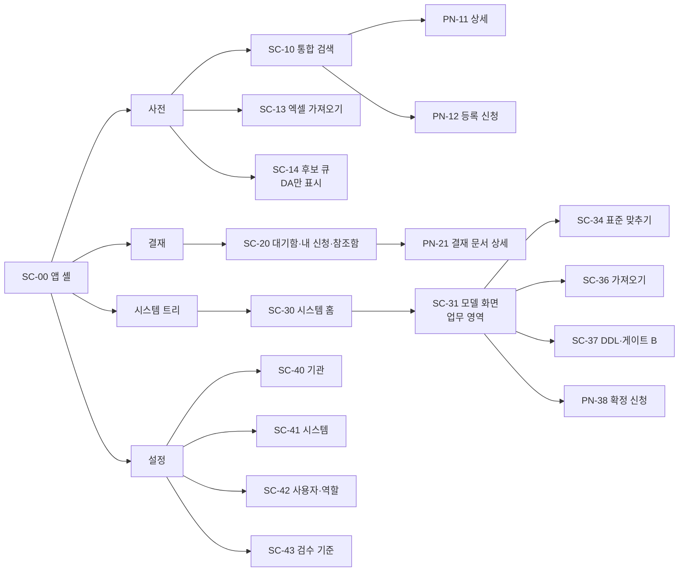
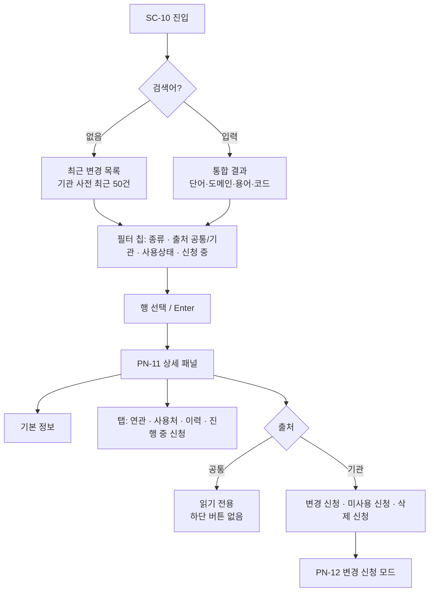
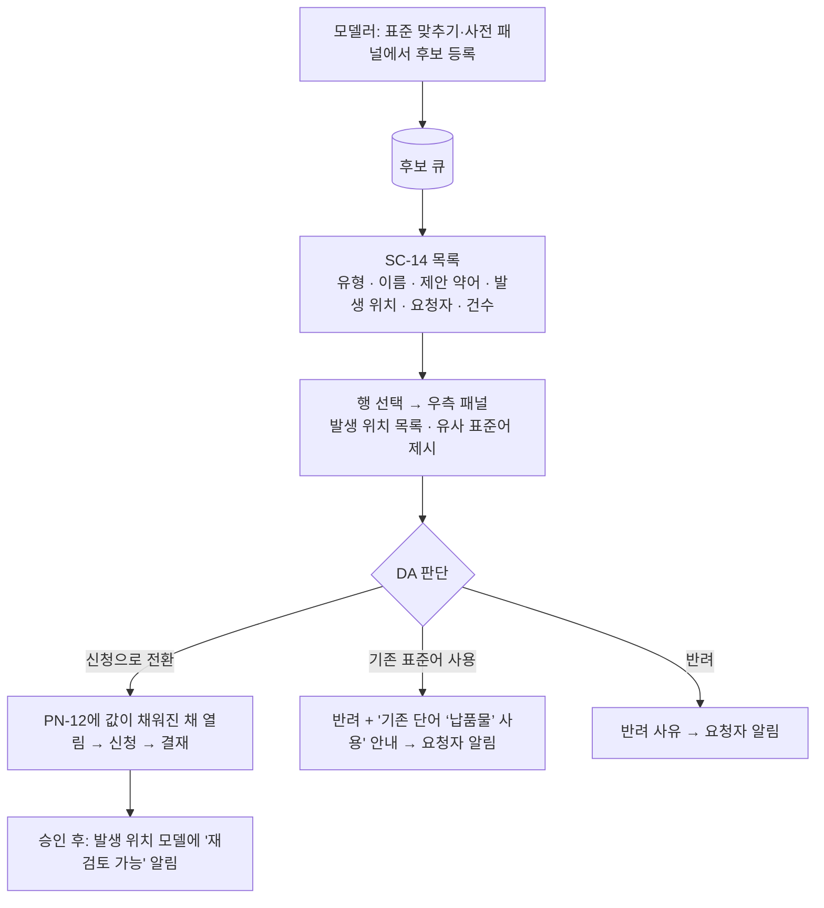
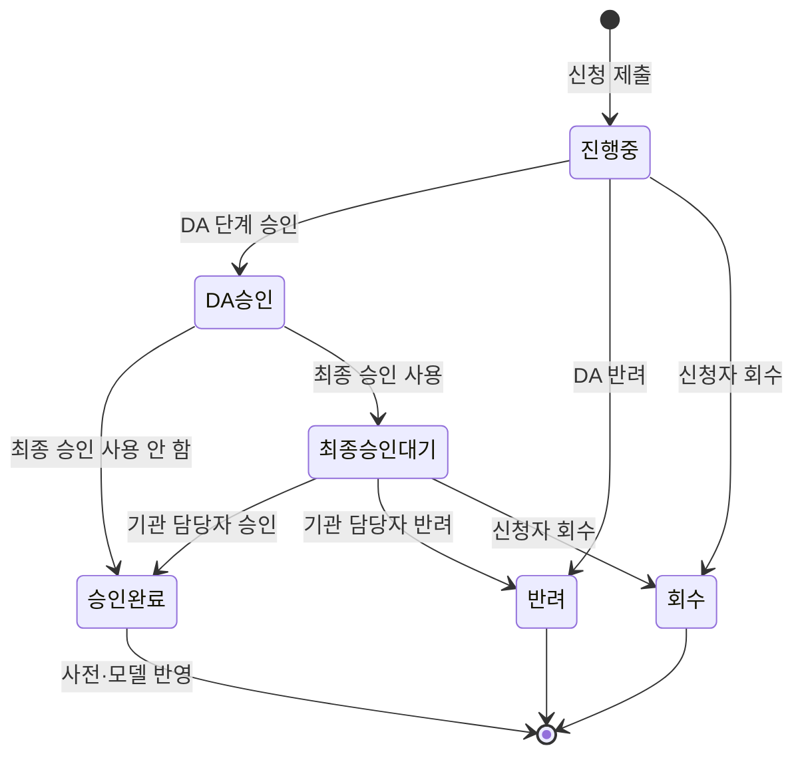
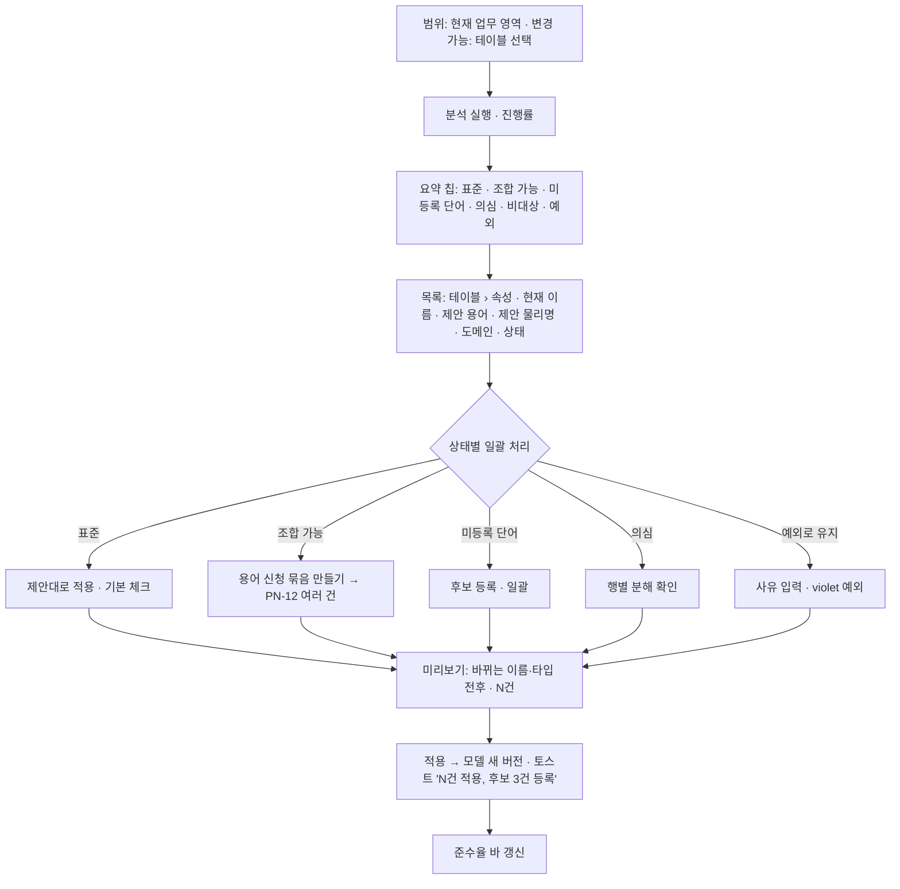
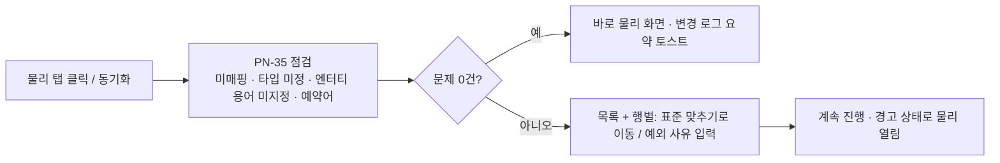
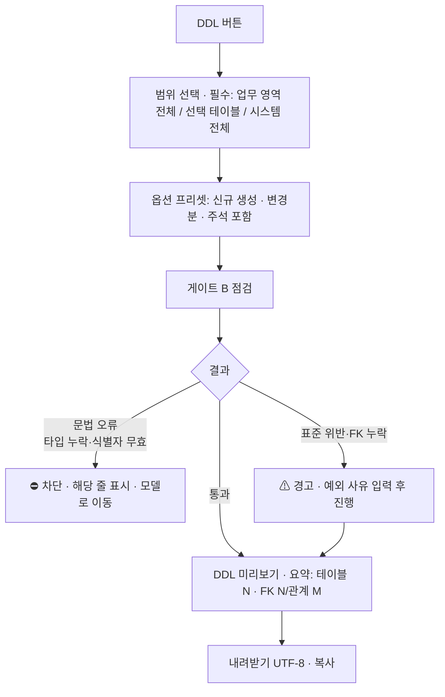

# DBModeler 화면 흐름 설계 v1

> 상태: **v1 초안** (2026-11-17). 다음 단계인 클릭 목업(`docs/ux/mockups/`)의 기준.
> 입력: [00-inputs.md](00-inputs.md)(제품 결정) · [01-design-guide.md](01-design-guide.md)(레이아웃·컴포넌트) · [30-metadata-design.md](../spec/da-feature-spec/30-metadata-design.md)(MD 시나리오) · [20-priority.md](../spec/da-feature-spec/20-priority.md)(요구사항·웨이브).
> 범위: 사전 관리 + 엑셀 가져오기 · 결재 · 표준 맞추기·게이트·준수율 · 기관·시스템 설정. ERD 캔버스는 **자리만** 잡는다(6-2).
> 표기: 화면 ID `SC-xx`, 패널 `PN-xx`, 모달 `MO-xx`. 괄호 안은 근거(입력 항목 번호·MD·요구사항).

## 1. 화면 목록

| ID | 화면 | 형태 | 주 사용자 | 근거 |
|---|---|---|---|---|
| **SC-00** | 앱 셸 (상단 바·좌측 내비·알림·명령 팔레트) | 공통 | 전체 | 1-5, 4-8 |
| **SC-10** | 사전 — 통합 검색 목록 | 목록 + 우측 패널 | 전체 | 3-5~3-7 |
| PN-11 | 사전 항목 상세 (연관·사용처·이력·진행 중 신청) | 우측 패널 | 전체 | 3-7 |
| PN-12 | 사전 등록 신청 (단어·도메인·용어·엔터티 용어·코드) | 우측 패널(넓게 560px) | 모델러·DA | MD-01~07, MD-30 |
| **SC-13** | 엑셀 가져오기 (업로드 → 검증·비교 → 결과 검토·보정 → 신청) — 왕복 편집은 [07](07-dict-excel-roundtrip.md) | 전체 화면 단계형 | 모델러·DA | 3-4, MD-08·09·10 |
| **SC-15** | 업로드 이력 (이어서 작업·보정본·반영본·보류 행·원본) | 목록 + 우측 패널 | 모델러·DA | 07 E4 |
| **SC-16** | 사전 변경 내역 (기간·종류·변경 구분 검색, 필드 비교, 엑셀 보고서 · 시점 비교는 W2) | 목록 + 우측 패널 | 전체 | 07 E5, MD-23 |
| **SC-14** | 후보 큐 | 목록 + 우측 패널 | DA | 5-4, MD-42·43 |
| **SC-20** | 결재 — 대기함 / 내 신청 / 참조함 | 목록 + 우측 패널 | 전체 | 4-1~4-8, MD-20~27 |
| PN-21 | 결재 문서 상세 (전후 값·검사 결과·결재선·예외 목록) | 우측 패널 | 전체 | MD-22 |
| MO-22 | 자기 승인 사유 입력 | 모달 | DA·기관 담당자 | 4-7, MD-25 |
| MO-23 | 반려 의견 입력 | 모달 | DA·기관 담당자 | MD-20 |
| **SC-30** | 시스템 홈 (시스템 개요·업무 영역 목록) | 페이지 | 전체 | 1-5 |
| **SC-31** | 모델 화면 = ERD 캔버스 + 준수율 바 + 패널 (v2 통합, 03-erd-editor) | 작업 화면 | 모델러 | 3-2, 5-1, 5-7 |
| PN-32 | 사전 사이드 패널 (검색·끌어 놓기·후보 등록) | 좌측 보조 패널 | 모델러 | 3-2 |
| PN-33 | 엔터티 패널 (속성·제약·인덱스·보안·관계 탭, 자동완성, 상태 배지) | 우측 패널 | 모델러 | 5-1, LG-R01~03, PH-R |
| PN-31G | 표 보기 (속성 그리드 · 일괄편집 · 찾기/바꾸기 · 비대상 지정) | 캔버스 위 오버레이 | 모델러 | M-H11·H12 (05 §8) |
| PN-39 | 모델 검토 (명칭 중복·미입력·관계·물리 정보) | 우측 패널 | 모델러 | M-D15 (05 §8) |
| **SC-34** | 표준 맞추기 (업무 영역 범위, 4상태, 일괄 처리) | 전체 화면 | 모델러 | 5-1, 5-2, ST-R07 |
| PN-35 | 게이트 A 점검 (물리 열기·동기화 시) | 우측 패널 | 모델러 | 5-6 |
| **SC-36** | 가져오기 (엑셀·DDL → 모델) | 전체 화면 단계형 | 모델러 | 1-8, RV-R01·R02 |
| **SC-37** | DDL 출력 + 게이트 B | 전체 화면 | 모델러 | OUT-R01·R02 |
| PN-37 | DBMS 비교 (모델 ↔ 운영 DB, 후속 차수) | 우측 패널 | 모델러·DA | M-P09 |
| **SC-38** | 산출물 (테이블 정의서·준수검사·용어 사용·개인정보·ERD·검토·변경 이력) | 목록 + 우측 패널 | 모델러·DA | OUT-R, M-D13·D14 |
| PN-38 | 모델 확정 신청 (결재선·참조자·예외 목록 확인) | 우측 패널 | 모델러 | 4-1, 5-5 |
| **SC-55** | 홈 (내 차례 결재·내 신청·최근 업무 영역·새 기능) | 페이지 | 전체 | 06 §3 |
| PN-50 · **SC-51** | 사용자 메뉴 · 마이페이지 (프로필·내 역할·내 신청·알림 설정·보안·환경) | 드롭다운 · 페이지 | 전체 | 06 §3 |
| PN-52 · MO-53 · PN-54 | 알림 센터 · 제품 정보(버전·빌드·릴리스 노트·라이선스) · 단축키 | 드롭다운 · 모달 | 전체 | 06 §3.1 |
| SC-57 | 오류·안내 (403·404·500·점검·로그아웃·세션 만료) | 페이지 | 전체 | 06 §3 |
| SC-58 | 감사 로그 | 목록 | DA·Admin | 06 §3, 06 §5 |
| **SC-40** | 설정 — 기관 (사전·결재선 템플릿·도메인그룹·메일) | 설정 페이지 | Admin | 4-2, 4-5, 4-8 |
| SC-41 | 설정 — 시스템 (DBMS·스키마·명명 템플릿·데이터타입 매핑·시스템 컬럼·최종 승인) | 설정 페이지 | Admin·DA | 1-7, 4-3, MD-40 |
| SC-42 | 설정 — 사용자·역할 | 목록 + 우측 패널 | Admin | 1-3, 4-4 |
| SC-43 | 설정 — 검수 기준 (사전 입력 형식 · 표준 제외 규칙) | 설정 페이지 | DA·Admin | 30 §4, M-O06 |

**1차 목업에서 뺀 화면 (W2)**: 삭제 보관·영구 삭제, 코드값 관리 전용 화면, 기관 대시보드. ~~버전별 이력 전체 화면~~ → **SC-16 사전 변경 내역으로 W1에 올림**(2026-11-18, 엑셀 왕복 편집 업무 반영 · 07 §7).

## 2. 내비게이션 구조



**좌측 내비 구성** (위에서 아래, 역할별 노출):

```
사전                       ← 전체
  통합 검색
  엑셀 가져오기
  후보 큐  (3)             ← DA 역할만
결재  (5)                  ← 대기 건수 배지
시스템
  ▸ 인사시스템  Oracle
      급여 · 인사기본 · 교육
  ▸ 회계시스템  Tibero
설정                       ← Admin·DA
```

- 역할을 겸할 수 있으므로(1-3) **메뉴는 권한에 따라 늘어난다.** 역할별로 따로 만든 화면은 없다.
- **상단 바**에는 기관명, 전역 검색(⌘K), 알림 벨(결재 요청·결과·참조·후보 처리), 사용자 메뉴(테마 전환·로그아웃)가 있다.

## 3. 사전 관리 흐름

### 3.1 SC-10 통합 검색 → PN-11 상세



| 상태 | 화면 처리 |
|---|---|
| 기관 사전 0건(설치 직후, 3-1) | 목록 위 배너: "기관 사전이 비어 있습니다. 공통표준 3,284 단어를 바로 쓸 수 있습니다." + [단어 추가] [엑셀 가져오기] |
| 검색 결과 0건 | 빈 상태 + "‘산출물’ 단어 등록 신청" 바로가기(검색어를 미리 채움) |
| 진행 중 신청이 있는 항목 | 행에 `신청 중` 배지, 상세 상단 배너 "변경 신청 대기 중 — REQ-2026-0012 (DA 승인 대기)" |
| 사용처 탭 | 경로 표시: `인사시스템 › 급여 › EMP_PAY_D › PAY_AMT` 클릭 시 SC-31로 이동 후 해당 속성 선택 |

목록 열(단어 기준): 상태 배지 · 출처 · 단어명 · 약어(mono) · 영문명 · 형식단어 · 도메인분류 · 버전 · 수정일.
- 용어: 용어명 · 약어(mono) · 도메인명(mono) · 타입·길이 · 유형(속성/엔터티).
- 도메인: 도메인명(mono) · 그룹 · 분류 · 타입·길이·소수점.

### 3.2 PN-12 등록 신청 (단건·여러 건)

```mermaid
flowchart TD
  A[+ 신청 ▾ 단어/도메인/용어/엔터티 용어/코드] --> B[PN-12 열림 · 560px]
  B --> C[입력 폼 · 위]
  C --> D{종류}
  D -- 용어 --> E[용어명 입력 → 입력 멈추면 분석]
  E --> E1{후보 수}
  E1 -- 1개 --> E2[자동 적용: 약어·구성 단어]
  E1 -- 여러 개 --> E3[후보 목록에서 선택 · 최대 30]
  E1 -- 0개(미등록 단어) --> E4[오류: '산출물' 미등록<br/>버튼: 단어 먼저 신청 · 후보 등록]
  E2 & E3 --> E5{1음절 포함?}
  E5 -- 예 --> E6[? 의심 배지 · 자동 확정 안 함<br/>확인 체크 필요]
  E5 -- 아니오 --> F
  E6 --> F[도메인 추천<br/>형식단어 분류 기준]
  D -- 엔터티 용어 --> G[엔터티명 분석 → 분류어 접미<br/>DLVRBL_M · 도메인 칸 숨김]
  D -- 도메인 --> H[도메인명 입력 → 분류명·타입·길이 자동 해석<br/>입력 중 기존 도메인 후보 표시]
  D -- 단어 --> I[단어명·약어 → 중복·복합어 검사 즉시]
  F & G & H & I --> J[목록에 추가 → 아래 대기 목록]
  J --> K[여러 건 추가 가능]
  K --> L[신청 사유 1~1,000자]
  L --> M[결재선 미리보기<br/>DA → 최종 승인(기관 설정 시) + 참조자 추가]
  M --> N[신청 제출 · Primary]
  N --> O[토스트: REQ-2026-0013 신청됨 · 결재 상태 보기]
```

| 규칙 | 화면 처리 (근거) |
|---|---|
| 검사 결과 표시 | 필드 바로 아래: ⛔ 차단(빨강) · 📝 사유 필요(사유 입력란이 나타남) · ⚠ 경고(확인 체크) (30 §4) |
| 제출 비활성 | 입력 중인 값이 목록에 안 들어갔거나, 오류 행이 있거나, 사유가 없으면 → 버튼 툴팁에 사유 |
| 결재선 | 템플릿 단계는 회색 고정(삭제 불가), 참조자만 추가(4-2, MD-26) |
| 같은 대상 대기 중 | ⛔ "이미 진행 중인 신청 REQ-… 이 있습니다" + 링크 (MD-10) |

### 3.3 SC-13 엑셀 가져오기 (자주 사용 · 3-4)

진입: SC-10 상단 [엑셀 가져오기], 좌측 내비, PN-32 사전 패널 하단.


| 단계 | 화면 요소 |
|---|---|
| 상단 | 단계 표시(1~6), 각 단계는 앞으로만 진행하고 [이전]으로 돌아감 |
| 3 열 매핑 | 파일 헤더 → DBModeler 필드 표. 자동 매핑 성공은 ✓, 미인식은 선택 상자. 필수 열 누락 시 다음 단계 차단 (ST-R04, F-06 방지) |
| 4 검증 | 행 수·진행률·남은 시간. UI 멈춤 금지, 백그라운드 진행 중 다른 화면 이동 가능 → 끝나면 알림 (F-20) |
| 5 결과 | 요약 칩: `정상 120` `동일 840` `대기 중 3` `충돌 7` `오류 12` `후보 선택 필요 4` → 칩을 누르면 해당 행만 필터. 행을 선택하면 우측 패널에 원본 값과 적용 값 비교, 사유, 수정 방법 |
| 5 후보 선택 | 용어 행에 후보 여러 개면 행 안에서 드롭다운으로 선택 (MD-09) |
| 5 오류 처리 | [오류 행 엑셀로 내려받기] → 원본을 고쳐 다시 업로드하면 같은 단계로 돌아옴 |
| 6 신청 | "정상 120건만 신청합니다. 동일 840건은 건너뜁니다." + 사유 + 결재선 미리보기 → [120건 신청] |

### 3.4 SC-14 후보 큐 (DA)



- 같은 이름의 후보가 여러 모델에서 들어오면 한 행으로 묶고 건수를 표시한다.
- 모델 속성에는 `후보 대기` 배지가 붙는다(무채색 + violet 점). 작업은 계속할 수 있다(5-4).

## 4. 결재 흐름

### 4.1 결재선 모델 (MD-20)



| 결재 문서 유형 | 1단계 | 최종 승인 적용 기준 |
|---|---|---|
| 사전 신청 (등록·변경·미사용·삭제, 후보 전환 포함) | DA (필수) | 기관 설정 "사전 신청 최종 승인" (4-5) |
| 모델 확정 | DA (필수) | 해당 시스템 설정 "모델 확정 최종 승인" (4-3) |

### 4.2 SC-20 대기함 → PN-21 상세 → 처리

```mermaid
flowchart TD
  A[알림·메일·좌측 배지] --> B[SC-20 탭: 대기함 · 내 신청 · 참조함]
  B --> C[필터: 문서 유형 · 상태 · 요청자 · 기간]
  C --> D[행 선택 → PN-21]
  D --> D1[머리: 신청번호(mono) · 유형 · 요청자 · 결재 단계 표시]
  D --> D2[본문: 사유 · 항목별 전후 값 비교<br/>신청 시점 검사 / 현재 기준 검사 구분]
  D --> D3[모델 확정이면: 준수율 · 표준 예외 목록 · 변경 요약]
  D --> E{내 차례?}
  E -- 아니오 --> E1[읽기 전용 · 하단: 신청자면 회수]
  E -- 예 --> F[하단: 반려 · 승인]
  F -- 승인 --> G{내가 신청자?}
  G -- 예 --> MO22[MO-22 자기 승인 사유 필수]
  G -- 아니오 --> H[현재 기준 재검사]
  MO22 --> H
  H -- 통과 --> I[다음 단계로 · 마지막이면 반영 → 토스트·알림·메일]
  H -- 실패 --> J[배너: 재검사 실패 사유 · 승인 취소됨 · 이력 기록]
  F -- 반려 --> MO23[MO-23 의견 필수] --> K[신청자에게 반려 · 알림·메일]
```

| 탭 | 내용 |
|---|---|
| 대기함 | 내 역할이 처리할 단계에 있는 문서만. 기본 정렬은 오래된 순 |
| 내 신청 | 내가 낸 문서 전체. 반려 건은 [다시 신청](현재 규칙으로 새 신청번호) |
| 참조함 | 나를 참조자로 지정한 문서. 처리 버튼 없음, 읽음 표시 |

- 역할 겸임(1-3): 모델러 겸 DA가 신청을 내면 그 문서가 바로 자기 대기함에 들어온다. 신청 완료 토스트에 [바로 검토] 링크를 둔다.
- 자기 승인 사유는 결재 이력과 감사 로그에 남고, PN-21 결재 단계 옆에 `자기 승인` 배지로 보인다.

## 5. 모델·표준 맞추기 흐름

### 5.1 SC-31 모델 화면 레이아웃

```
┌ 상단 바 ─────────────────────────────────────────────────────────────────┐
├ 내비 ┬ 페이지 헤더: 인사시스템 › 급여   [논리|물리]   [가져오기][DDL][확정 신청] ┤
│      ├ 준수율 바: 준수율 92% · 미준수 6 · 예외 2 · 미산정 1 · 후보 대기 3 [표준 맞추기] ┤
│      ├────────────┬──────────────────────────────────┬───────────────────┤
│      │ PN-32      │  ERD 캔버스 (자리)                │ PN-33 속성 패널     │
│      │ 사전 패널   │  · 엔터티 박스에 상태 점          │ 엔터티/속성 편집     │
│      │ 280px      │  · 선택 → 우측 패널               │ 자동완성·상태 배지   │
│      │ (접기 가능) │                                  │                   │
└──────┴────────────┴──────────────────────────────────┴───────────────────┘
```

| 요소 | 동작 (근거) |
|---|---|
| 준수율 바 | 현재 업무 영역 기준. 숫자를 누르면 SC-34가 그 상태로 필터되어 열림. 평가 대상이 없으면 "미산정" (5-7, MD-55) |
| [확정 신청] | 미준수 0건(사유 있는 예외 제외)일 때만 활성. 비활성이면 툴팁 "미준수 6건 — [표준 맞추기 열기]" (5-5) |
| [논리|물리] | 물리로 전환할 때 게이트 A(5.4) |
| 캔버스 | 이번 목업은 정적 그림 + 엔터티 클릭 → PN-33만 (6-2) |

### 5.2 입력 즉시 맞추기 (PN-33 · 5-1①)

```mermaid
flowchart TD
  A[속성명 입력 '산출물명'] --> B[자동완성 드롭다운<br/>용어명 · 약어(mono) · 도메인 · 상태]
  B --> C{선택}
  C -- 표준 용어 선택 --> D[논리명·물리명·타입·길이 채움<br/>참조 서명 저장 · ✓ 표준]
  C -- 일치 용어 없음 --> E[분석 결과 표시]
  E --> E1{분석}
  E1 -- 조합 가능 --> E2[＋ 조합 가능 · 버튼: 용어 신청 / 후보 등록]
  E1 -- 미등록 단어 --> E3[! 미등록 단어 · 기본 버튼: 후보 등록]
  E1 -- 의심 --> E4[? 의심 · 분해 확인 필요]
  C -- 그냥 입력 유지 --> F[미매핑 · 준수율 바에 반영]
```

엔터티 이름 칸도 같은 방식이다. 엔터티 용어로 자동완성되고, 분류어 접미가 적용된다(예: `산출물기본` → `DLVRBL_M`).

### 5.3 SC-34 표준 맞추기 일괄 화면 (5-1②, 5-2)

진입 경로:
- 준수율 바의 [표준 맞추기]
- 가져오기(SC-36) 완료 직후 **자동 오픈**
- 확정 신청 비활성 툴팁의 링크



- "숨은 단계 금지"(F-21): 미리보기 → 적용을 한 화면에서 한다. [적용] 버튼에 바뀌는 건수를 표시한다.
- 엔터티 행(테이블명)도 같은 목록에 넣는다. 엔터티 용어 미지정·접미 불일치도 판정 대상이다(MD-54).

### 5.4 게이트 A — 물리 열기·동기화 (5-6)



게이트 A는 차단하지 않는다(Q-3). 예외 사유는 모델 확정 결재의 예외 목록에 모인다(5-3).

### 5.5 SC-37 DDL 출력 + 게이트 B



### 5.6 SC-36 가져오기 (엑셀·DDL → 모델 · 1-8)


### 5.7 PN-38 모델 확정 신청

```mermaid
flowchart TD
  A[확정 신청 · 활성 조건: 미준수 0건] --> B[PN-38]
  B --> B1[요약: 준수율 · 예외 N건 목록 · 직전 확정 대비 변경]
  B --> B2[결재선: DA → 최종 승인(시스템 설정 시) · 참조자 추가]
  B --> B3[사유]
  B3 --> C[신청 → 모델 '검토 중' 잠금<br/>편집 불가 배너 · 회수 가능]
  C --> D[SC-20 결재 흐름]
  D -- 승인 --> E[확정 버전 기록 · 편집 재개는 새 작업본]
  D -- 반려 --> F[잠금 해제 · 반려 의견 배너]
```

## 6. 설정 흐름

| 화면 | 구성 | 저장 |
|---|---|---|
| SC-40 기관 | 기관명 · 기관 사전 이름 · **사전 신청 최종 승인 사용**(토글) · 결재선 템플릿(유형별 단계 목록, 단계 역할) · 메일(SMTP·발신 주소·테스트 발송) | 페이지 하단 [저장], 변경 항목 강조 |
| SC-41 시스템 | 목록 + [시스템 추가]. 상세: 이름 · **DBMS**(Oracle/PostgreSQL/Tibero/MySQL) · 기본 스키마 · 명명 템플릿(테이블·PK·FK·인덱스 미리보기) · **모델 확정 최종 승인**(토글) · 업무 영역 목록 | DBMS·템플릿 변경 시 영향 미리보기(재검토 컬럼 수) 후 저장 (MD-40) |
| SC-42 사용자·역할 | 사용자 목록 + 우측 패널: 역할 체크(모델러 · DA · 기관 담당자 · Admin, **중복 선택 가능**) · 담당 시스템 | 즉시 저장 + 토스트 |
| SC-43 검수 기준 | 탭: 단어 · 도메인 · 용어 · 코드 → 필드별 필수·길이·허용 문자·차단/경고 | 저장 시 "이전 기준으로 검증한 엑셀은 다시 검증해야 합니다" 배너 |

## 7. 교차 시나리오 (목업 클릭 경로)

목업은 아래 5개 경로를 끝까지 클릭할 수 있게 만든다.

| # | 시나리오 | 경로 |
|---|---|---|
| T1 | 설치 직후 첫 사용 | SC-10 빈 상태 배너 → SC-13 엑셀 가져오기 1~6 → 토스트 → SC-20 대기함(겸임 DA) → PN-21 → MO-22 자기 승인 → SC-10 기관 항목 표시 |
| T2 | 신규 설계 중 표준 맞추기 | SC-31 → PN-33 속성 입력 → 자동완성 선택(✓) → 미등록 단어 입력 → 후보 등록 → 준수율 바 변화 |
| T3 | 현행 DB 표준화 | SC-31 [가져오기 ▾ DDL] → SC-36 → SC-34 자동 오픈 → 상태별 일괄 처리 → 미리보기 → 적용 → 준수율 바 |
| T4 | 후보 → 사전 → 모델 | SC-14 후보 선택 → 신청으로 전환 → PN-12 → 결재 승인 → 모델 '재검토 가능' 알림 → SC-34 적용 |
| T5 | 모델 확정 | SC-31 [확정 신청](비활성 툴팁) → SC-34로 해결 → 게이트 A 예외 사유 → PN-38 → SC-20 DA 승인 → 최종 승인(기관 담당자) → 확정 배너 |

## 8. 열린 질문 결정 (2026-11-17)

| ID | 질문 | 결정 |
|---|---|---|
| UX-Q1 | 사전 패널과 속성 패널을 함께 열면 작은 화면에서 캔버스가 좁다 | **1920 기본, 최소 1600까지만 축소 — 확정** (목업 v1 확인 후, 2026-11-17) — §8.1 |
| UX-Q2 | 모델 확정 후 편집 방식 | **다음 작업 버전으로 진행.** 확정본은 읽기 전용 기록으로 남고, [편집 시작]을 누르면 확정본 내용을 그대로 이어받은 작업 버전(v N+1)이 열린다. 상단에 "v3 확정본 기준 작업 중 · 확정본과 비교" 배너를 둔다 |
| UX-Q3 | 메일 알림 범위 | **결재선 담당자에게 전송.** 결재 요청은 지금 차례인 단계의 결재자에게, 결과(승인·반려)와 회수는 신청자와 앞 단계에서 이미 처리한 결재자에게 보낸다. 참조자·후보 처리·재검토 알림은 앱 알림만 보낸다 |

### 8.1 UX-Q1 — 1920 고정 설계와 작은 화면 대응

> **2026-11-17 확정**: 정보량이 많아 화면을 크게 줄이기 어렵다는 판단으로 **1920 기본, 최소 1600**으로 정했다. 목업 v1에서 1600 배치를 확인했다.
> - 모델 화면은 캔버스 약 760px로 3단 배치가 가능하다. 캔버스는 이동·확대로 대응한다.
> - 결재 상세 380px도 읽힌다.
> - 아래 "채택 규칙"의 1366~1599 구간은 쓰지 않는다.
>
> | 화면 폭 | 배치 |
> |---|---|
> | **1920 이상 (기준)** | 내비 224 · 사전 패널 280 · 캔버스/목록 · 우측 패널 420. 넓어지면 캔버스·목록만 커짐 |
> | **1600~1919** | 내비 224 · 사전 패널 240 · 우측 패널 380. 글자·행·클릭 영역은 그대로 |
> | **1600 미만** | 화면 최소 폭을 1600으로 유지(이하에서는 페이지 가로 스크롤) + 상단에 "1600px 이상 화면을 권장합니다" 배너. 1366 대응 레이아웃은 만들지 않음 |
>
> - 목업: 1920×1080 기준 프레임 + 1600×900 확인 프레임(SC-31 모델, SC-20 결재) 2개.
> - 목업에서 확인할 것: 1600 폭에서 모델 화면에 사전 패널·캔버스·우측 패널을 함께 열 때 캔버스 폭이 쓸 만한지(약 830px 예상). 결재 상세 패널 380px에서 전후 값 비교 표가 읽히는지.
>
> 아래는 처음 검토한 내용이다(1366 지원 전제).

**검토한 방식**

| 방식 | 장점 | 문제 (UX 관점) |
|---|---|---|
| A. 화면 폭을 1920px로 고정(`min-width:1920px`) | 레이아웃이 하나라 설계·개발·검수가 단순함 | 1366·1440·1600 화면에서 **가로 스크롤**이 생긴다. 오른쪽 우측 패널과 [확정 신청]·[승인] 같은 주 행동 버튼이 화면 밖으로 밀려 발견되지 않는다. 표의 가로 스크롤과 페이지 가로 스크롤이 겹쳐 조작이 헷갈린다 |
| B. 1920 화면을 비율로 축소(`zoom`·`scale`) | 배치가 그대로 유지됨 | 1366에서 약 71%로 줄어 표 글자 13px → **약 9px**가 되어 읽을 수 없다. 클릭 영역도 32px → 23px로 작아진다. 업무 도구에는 부적합하다 |
| **C. 1920 기준 설계 + 정해진 축소 구간 (채택)** | 1920에서는 설계 그대로 보이고, 작은 화면에서도 글자 크기와 주 행동을 지킨다 | 구간별 규칙을 미리 정해야 한다(아래 표). 목업은 1920 하나만 만들고 구간 규칙은 문서로 정의한다 |

**채택 규칙 (C)**

| 화면 폭 | 배치 | 바뀌는 점 |
|---|---|---|
| **1920 이상 (기준)** | 내비 224 · 사전 패널 280 · 캔버스/목록 · 우측 패널 420 | 설계 그대로. 1920을 넘으면 캔버스·목록만 넓어지고 패널 폭은 그대로 |
| 1600~1919 | 내비 224 · 사전 패널 240 · 우측 패널 380 | 패널을 조금 좁힌다. 글자 크기·행 높이는 그대로 |
| 1366~1599 | 내비 **56(아이콘)** · 사전 패널 **겹쳐 열기**(캔버스 위, 닫으면 사라짐) · 우측 패널 360 | 동시에 열리는 패널을 하나로 줄인다. 주 행동 버튼은 페이지 헤더에 그대로 둔다 |
| 1366 미만 | 지원하지 않는다 | "1366px 이상 화면에서 사용해 주세요" 안내. 결재 조회만 읽기 전용으로 허용 |

**지켜야 할 것 (모든 구간)**
- 글자 크기·행 높이·클릭 영역(32px)은 줄이지 않는다. 줄이는 것은 패널 폭과 동시에 열리는 패널 수다.
- 주 행동(신청 제출·승인·확정 신청·적용)은 항상 화면 안에 있다. 가로 스크롤 영역에 넣지 않는다.
- 가로 스크롤은 **표 내부에만** 허용하고, 첫 열(이름)과 상태 열은 고정한다. 페이지 전체 가로 스크롤은 쓰지 않는다.
- 사용자가 끌어서 바꾼 패널 폭은 화면 폭 구간별로 기억한다.
- 목업은 **1920×1080 고정 프레임**으로 만든다. 설계 확인과 시연에 쓰는 기준 화면이다. 1366 구간은 핵심 화면 2개(SC-31 모델, SC-20 결재)만 추가 프레임으로 보여 준다.
